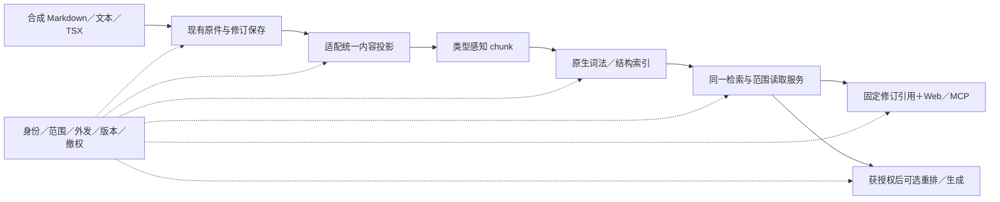
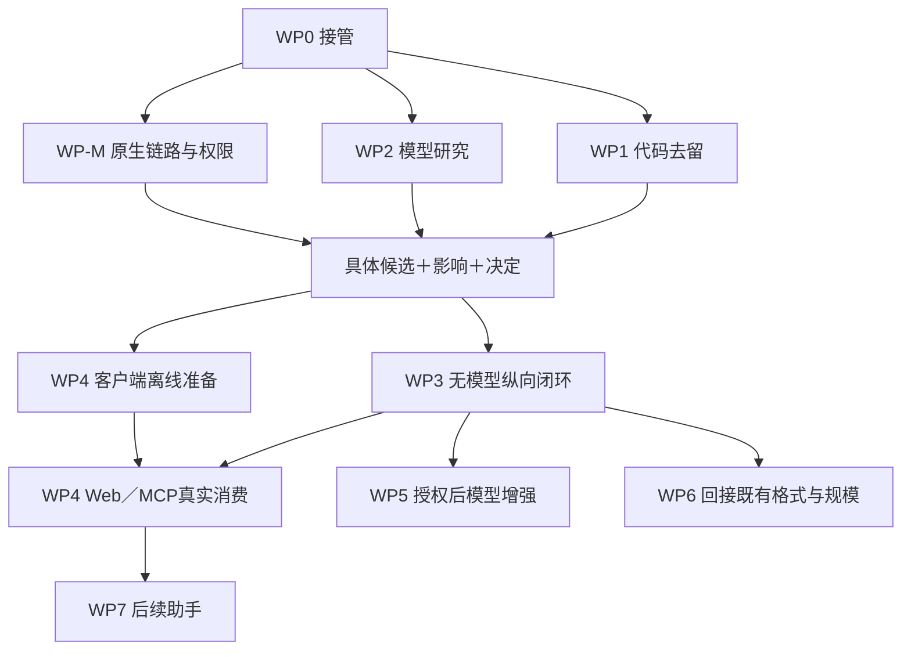

# 知识库主线重排与协作计划

**2026-10-30 最新状态：真人要求暂停全部会话。** 三个开发会话已保存检查点并交回写窗口；当前仅执行已授权的保存、提交和推送。恢复入口见[暂停检查点](knowledge-core-pause-checkpoint-20261030.md)；不得根据下文历史Active或旧写窗自动恢复。

日期：2026-10-29；版本：1.12。主协调会话：`01a18185-7d13-7b43-af32-f6c03ab768f6`（第二大脑｜知识库主线统筹）。本文件是新的执行入口；旧阶段号只用于追溯，既有冻结接口和历史验收保留原范围。

资料采用[当前参考基线](knowledge-core-reference-authority.md)；本计划是当前工作计划，未因锁定而变成人的验收或接口冻结。后续任务按引用锁的用途与章节读取，链接不自动扩大可信范围。

## 1. 目标与本轮交付

在 RAGFlow 已有 MVP 上改造一个可由 Web 和标准 MCP 客户端共同消费的知识库。通用助手是知识服务的消费者；当前不开发人格、记忆或新的 Agent runtime。优先交付“保存→统一结构→类型感知分块→可选索引→召回→准确回源”的纵向链路，再在对应模型授权下接可配置重排与生成。

接管、研究和具体候选已完成；真人已批准KCLS-20261028-01实施并创建三个独立开发会话。后端、Web和MCP源码均已实现/接入并停写交回，定向组件及完整构建通过；首片同版隔离原生服务、Web与两个MCP客户端合成验证已完成。真人随后明确要求继续原主线，先补齐统一数据结构、已有解析器转换及同服务分块/入库/召回/回源，再实测复杂数据最终召回质量和MCP实际作用。当前统一基础Active，未进入质量评测。边界见[首片设计](knowledge-core-lexical-slice.candidate.md)及[本轮执行记录](knowledge-core-execution-record.json)。**本片工程验证通过不代表整个统一模型、部门授权、临时Grant或产品已验收/发布。** 产品原话仍逐字保存在[需求与执行记录](knowledge-core-realignment-record.json)的 `request_snapshot.original_text`。

| 当前事实 | 已核依据与边界 |
| --- | --- |
| 主仓库与源码 | `codex/stage3r2-document`，HEAD `7233c495311f1c40c67254582138169d5ed0e205`；接手时工作区清洁。`7179525`、`7233c49`尚未推送，保留；main仍`abdb141` |
| 当前运行 | 原POC的Go `dfc10da5…7065`与Web index `eb8686f0…a610`再次实核不变；本片另用API 127.0.0.1:29380 / Web 29381及全新专用依赖，未替换POC或部署 |
| 已有内核 | C1/C3域／分组／修订／确定性节点；R1代码及Markdown结构；R2文档表示与自然源定位。具体源码与路由见[盘点](knowledge-core-inventory.md) |
| 当前断点 | 旧C1/R1/R2字段原义保持；新增默认关闭的owner本地词法链已完成后端组件验证，Web/MCP均已接入，真实签名HTTP、浏览器和两个具名SDK业务已验证；原有禁模型及入库闸门保留 |
| R2存量 | 正式后端与Web存在；700请求核心、6故障、跨代码／文档quota及三格式任务／读取／RSS已有私有证据。最终浏览器和统一报告未收尾，人的验收Pending；不重跑已通过的大量实验 |
| 保护范围 | 47冻结／历史候选文件原字节保持，清单位于`stage3r2-document-backend-verification.json.contracts.protected_files`；LICENSE、源归属、旧失败和真实数据保留 |

远端分支状态为接手时已存在的远端跟踪引用；本轮不把未执行的新远端查询或推送写成结果。旧POC的6份来源／42块／5题仅是旧原生样本，不代表本次链路已经适配。

## 2. 产品分层与知识域语义

| 层 | 职责 | 当前取舍 |
| --- | --- | --- |
| 归属与授权 | 谁拥有／协作哪些知识，谁能执行哪些动作，内容能否外发 | 原生用户、Tenant/UserTenant、Dataset为起点；补精确范围与凭据生命周期，避免再造一套租户系统 |
| 知识内核 | 原文、不可变修订、内容节点、父子／事实边、源位置、附件指向、有效策略 | 统一已有C1/R1/R2投影；一个概念不强制一张新表 |
| 转换与检索 | 清洗／转换、分块、索引发布、召回、可选重排、证据输出／生成 | 在原生parser／pipeline／DocEngine／Provider拥有层适配；不建设第二后端 |
| 消费端 | Web知识浏览／检索、MCP工具、后续助手 | 共用同一知识服务、授权和引用含义；MCP从第一版设计即纳入 |

**知识域是一份可解释的知识集合及访问边界；主题分类、组织归属、内容树分别表达。** 一个域继续对应一个原生Dataset身份。个人、部门A、部门B可各有域；“研发部”不能只写进`category`就视为成员隔离。

1. 归属沿用原生`TenantID`、`CreatedBy`及成员身份。部门如何映射已有成员／精确域授权是候选设计，当前未实现；`team`表示整个原生tenant，不能冒充部门权限。
2. `KnowledgeGroup`只负责域内项目／主题／模块组织；不授予权限，不成为新的租户层。来源内的`parent`只表达同修订内容结构。
3. 初版细粒度访问使用显式允许的域、来源或节点范围；组织关系只用于解析授权主体，不能由标签、路径前缀、检索命中或关系边推导权限。
4. 所有读取、搜索、父子扩展、关系、附件、计数、续页和结果输出均受有效授权交集约束。跨域关联不授予另一域的读取权。

## 3. 最小统一模型候选

下表是设计候选，**不是已冻结DTO或新增数据库表**。实际字段名、版本兼容和路由在WP2形成具体候选；确认前不接入业务。

| 必要概念 | 最小信息／不变量 | 首要承载与缺口 |
| --- | --- | --- |
| 域上下文 | 原生domain/dataset身份、原生归属主体、策略版本；主题与分组独立 | `Knowledgebase`、`KnowledgeDomain`；补部门协作／精确授权语义，保留旧owner-only契约 |
| 来源与修订 | 稳定source、不可变revision、原始对象指向、原件摘要、媒体类型／编码、采集来源与生命周期 | `Document`、`FileCommitItem`、`KnowledgeSourceRevision`；不重复存原件或再建版本引擎 |
| 内容表示 | 同一revision的原文／代码／文档结构表示、producer与配置版本、完整性／不支持项 | R1固定view及R2representation；统一读取投影，旧ID／摘要规则不改 |
| 内容节点 | kind、同版父级及顺序、必要文本／结构化值、来源绑定；节点不等于chunk | C1/R1节点与R2文档节点；typed ParseResult作为转换原料，必要字段白名单化 |
| 源位置 | 坐标系+可核查范围；代码原字节／行、PDF物理页、PPT源slide、DOCX源部件／段／表单元 | 复用已有自然locator和原文字节窗口；派生UTF-8坐标不能冒充原件坐标，位置缺失明确标记 |
| 事实关系与附件 | 两端同版引用、关系类型／提取依据／确定性；附件原对象或受控引用 | R1事实边、R2attachment/reference；不自动下载远程内容，不为关系新增图数据库 |
| 处理计划 | 节点／词法／结构／向量分别选择；配置版本、实际模型需求与产物状态可见 | 适配原生Pipeline/Tokenizer与策略检查。关闭向量须阻止实际encoder调用，不等同省略模型名 |
| 索引投影／检索证据 | chunk/index行→node→revision→locator；索引版本／有效视图；命中原因及可回读内容 | 复用原生chunk/DocEngine，补固定来源映射及发布过滤；不是另一套权威内容 |
| 有效授权 | 身份、域／模块／显式内容范围、动作、外发、期限／撤销版本 | 统一服务端解析；metadata不承载可自我声明的权限，临时钥匙不含模型Key或owner凭据 |

开源对照限三项，详见[模型研究](knowledge-core-model-research.md)。借鉴语义节点与provenance分离、节点关系和metadata用途分离；不照搬整个运行框架或把metadata当ACL。完整[统一内容草案](knowledge-core-unified-model.candidate.md)与[访问候选](knowledge-core-local-access.candidate.md)仍Draft_NotFreezeReady；其中首片所需身份、持久映射和严格schema已另行收敛为[具体候选](knowledge-core-lexical-slice.candidate.md)，这一小片已获独立实施决定，完整模型与Grant仍未冻结。

## 4. 第一条纵向链路



第一片先用现有Markdown、文本和TSX结构，显式禁止远程取图、Embedding、重排、生成等模型支路。原生Markdown默认行为与Tokenizer默认`full_text+embedding`必须逐入口核实；`embedding_model`留空、只走搜索页面或绑定一个旧域都不能证明零模型。

现有注册知识域的常规搜索还受`OperationUse/Run→generation`闸门约束；需要在具体候选中区分本地搜索／读取和模型使用，**保持旧禁模型语义**，增加窄范围的新能力，不能直接移除全局检查。原生`RetrievalTest`也不能直接作为零向量路径。详见[完整调用链](knowledge-core-retrieval-mcp.md)。

大文件沿用有界原文／关键词／结构定位；代码只在策略选择时向量化。首片不开发OCR、更多复杂表格、视觉还原、人工Wiki或通用Agent功能。

## 5. 工作包、负责人和交付顺序

研究阶段使用主协调者与3个研究子Agent，均已交回。持续业务开发采用后端、Web、MCP三个独立会话；实时状态与ID见本轮执行记录的development_dispatch。下表保留工作包职责；具体写窗另行逐次签发，表格本身不授予源码／Git／部署权。

| 包 | 负责人／本轮状态 | 输入→输出 | 依赖、复用与验收 |
| --- | --- | --- | --- |
| WP0 接管与排程 | 主会话；已接管 | 指令／Git／运行／旧证据→唯一计划、权限台账、原话记录 | 核分支、47保护、未推提交、运行摘要；旧主停写，三项只读任务实际启动 |
| WP1 代码去留盘点 | `/root/code_inventory`；首轮只读 | 入口／路由／依赖／自研增量→保留／适配／冻结／删除候选矩阵 | 不依赖新接口。每项附引用及删除前验证；无依据不删Python/native资源；主控先形成清单再执行有界清理 |
| WP2 统一模型与边界 | `/root/content_model_research`提供研究，主会话持候选 | 当前typed/C1/R1/R2＋3个官方项目＋权限盘点→最小具体模型／索引／检索契约及影响清单 | 与WP1/WP-M并行研究；复用原生身份、源修订和表示。旧保护不改；新增共享接口须绑定具体版本／摘要取得决定后接业务 |
| WP-M 原生检索与MCP权限设计 | `/root/retrieval_mcp_permissions`；首轮只读 | 原生入库／搜索／Provider／MCP→调用图、断点、范围矩阵、最短适配路径 | 与WP1/WP2并行。区分MCP客户端管理与知识服务端；真实实现、stub、默认模型支路逐项区分 |
| WP3 无模型纵向切片 | 独立后端会话实现；主会话统一集成与复核，源码窗已交回 | 已确认WP2候选＋3类合成样本→保存／统一投影／类型感知chunk／词法结构召回／固定引用 | 依赖相关候选确认；复用FileCommit、R1、原生Pipeline/DocEngine；只有缺口自研桥接与发布过滤。须实际SQL/对象/检索引擎HTTP与零模型证据，Mock不算闭环 |
| WP4 Web与MCP最小消费 | 已授权Web与MCP独立会话完成接入；源码窗已交回，主会话核实际消费 | WP3固定服务／错误／权限→同一结果的Web查看与原生MCP工具适配 | 在共享语义明确后可并行准备合成客户端；共享检出实施与Go交替。至少两个具体客户端的初始化／发现／调用／错误／撤权互通；只报告实际验证客户端 |
| WP5 可选向量／重排／生成 | 主会话＋用户定参数，生产／消费角色按写窗执行 | WP3固定数据、离线结果及对应模型范围授权→可配置增强与比较报告 | 原生Tokenizer/Provider/重排/生成优先适配；模型／维度／chunk预算／召回／重排参数在样本测试时商定，当前全部NotRun |
| WP6 既有格式回接与规模 | 主会话统一分配转换与验证任务；本轮冻结扩展 | WP3统一投影＋已有R2适配器→PDF/PPTX/DOCX同链、按实际需求扩展 | 先核现有结果，不重做解析器；保留R2未验边界与失败。链路可用后才扩格式、真实样本与规模；范围和单位单独记录 |
| WP7 后续通用助手 | 后置；未启动 | 稳定知识服务/MCP→开源Agent框架消费 | 不阻塞知识库；不自行重写runtime，当前不做人格／记忆 |



并行的是独立研究、合成输入、客户端离线准备和证据整理。拥有同一契约或共享检出的变更不并行写入；不以开多个完整实现路径制造分叉。

## 6. 每阶段可操作验收

| 阶段 | 操作与工程通过条件 | 不代表的结论 |
| --- | --- | --- |
| 当前盘点／计划 | 原话逐条覆盖；三份矩阵有文件／路由／依赖证据；官方项目有精确来源；旧47件／LICENSE及运行摘要不变；单写入与后续依赖明确 | 产品已完成、用户已验收、新接口已冻结 |
| 统一候选 | 每类现有对象能映射同一source/revision/node/locator；原始与派生坐标明确；归属／分类／授权分离；失败、不支持、旧版本及影响有正反例 | 适配器运行或部门成员权限已上线 |
| 转换准确性 | 合成Markdown标题／段落／表格，文本中英文及换行，TSX符号／import及原文字节均有预标事实；逐项比内容、顺序、位置和修订；不得以chunk数量代替提取准确性 | 真实复杂PDF、扫描件或任意代码语义准确 |
| 类型感知chunk | 在已核正确的统一内容上单独检查：代码符号／文档章节／表格行界；所需文本覆盖，位置不越界，不跨域／修订拼接；策略和不足可见 | chunk尺寸或Embedding参数已定最优 |
| WP3实际闭环 | 从正式入口保存3类合成来源，实际引擎可检索并回读固定revision与locator；修改后新旧版本明确；禁模型分支实际尝试0；重试／失败不会半发布或混版本 | 单元／Mock通过等于真实服务闭环，合成通过等于真实质量 |
| 权限贯穿 | 个人、部门A、部门B用合成主体／域；仅许可范围可搜索／读取／扩展；拒绝路径、统计、续页、附件、到期／撤销后缓存和旧引用均核对；外发独立判断 | UI隐藏等于授权，部门标签等于隔离 |
| MCP消费 | 标准协议握手、工具发现与schema、成功／拒绝／分页／取消适用路径；至少两个命名客户端实连，记录版本与能力；结果与Web同范围同修订 | 验证两个客户端等于已兼容所有Agent |
| 模型增强与质量 | 取得具体模型范围后，在固定快照与题集分别比较词法、结构、可选向量和重排／生成；记录实际调用、命中、证据支持、位置及成本 | 模型名已配置、旧5题或合成集等于新产品质量验收 |

检索相关性、chunk预算、Embedding维度／批次、召回候选数、重排和生成参数在测试阶段与用户商定；本轮不冻结。精确来源、正确修订、权限、禁外发和不伪造证据是基础不变量。历史60题／保留集等要求保留历史来源，是否纳入新一轮正式评估须明确数据及范围，不自动调用模型补齐。

## 7. MCP与授权设计要求

身份首先认证，继而解析允许域／模块／来源或节点范围、动作、有效期、撤销世代，再评估外发目标和用途。过滤必须进入原生检索候选、节点扩展与最终输出；任何外发重排／生成前再次核内容允许范围。解析后的scope不能由请求参数自行扩张。

临时凭据仅代表一个受限Grant，服务端保存其哈希及生命周期；不包含模型Key、tenant管理Key或owner nonce。工具发现、结果分页、引用回读、附件与缓存复用都重新受范围和撤销检查。默认工具可先是搜索、定位／范围读取和必要浏览；工具命名／schema在具体候选确定，不在本文发明已实现接口。

标准MCP是面向任意遵循协议客户端的目标；客户端支持的协议版本、传输、认证和可选能力有差异。原生服务端、管理外部MCP连接和项目新知识工具是不同拥有路径；只借用已核可用部分。

## 8. 单写入和交接规则

当前共享源码/Git/部署写窗持有人为本主会话。三名子Agent本轮分别获得独立ignored研究/离线草稿白名单，已完成并交回，未获得业务写权。真人澄清后，持续开发分工采用独立会话；当前子代理只负责研究与离线验证。旧主会话只读；“阶段2知识消费与前端”的真人只读限制继续有效。“R4 原件导入客户端与界面”无新写窗；需要时由主会话明确派发。

每次派发必须附引用锁ID、主控给出的引用锁文件SHA-256、允许资料条目ID／用途；接方先执行摘要校验并按受控入口只读指定章节／字段，再回报采用基线。旧文档若与新主线冲突，列出冲突交主控，不自行按文件名、时间或旧批准选择。子任务不得自行刷新锁或提升候选状态。

交写窗前：固定完整HEAD／分支，工作区清洁或逐项确认现场归属，列允许文件和47保护件，说明输入／输出／测试及部署边界。主会话交出源码写窗后停止共享源码／Git／部署写入，仅做明确分离的只读工作或授权的ignored草稿。不能两边checkout、commit、修改同一文件或重启后端。

接方回交：返回完整HEAD、逐文件变更、测试／构建与未测项、保护摘要、失败／重试、运行是否改变、未决依赖。主会话确认后收回写窗，执行同版集成。需要worktree时先核合适现存worktree并统一创建、分配、集成；本轮未创建。

```text
任务ID / 主控签发方 / 负责人
固定分支 + 完整HEAD + 工作区状态
引用锁ID + 主控给出的锁文件SHA-256 + 允许资料条目ID/用途
原话条目 / 输入契约版本与SHA / 合成fixture版本
允许读写路径 / 保护路径与SHA / Git与部署权
输入 → 输出 / 直接复用 → 适配 → 必要自研
依赖 / 明确不包含项 / 完成判据与测试命令
事实证据（源码行号、实际日志摘要）/ 推断与未知分列
失败与重试（保留原键和失败）/ 影响与剩余项
回交完整HEAD / 测试结果 / 当前运行版本 / 写窗交回声明
人的决定：Pending，除非有绑定本交付的真实决定
```

触发立即回报：发现模型／资料范围扩大、接口／权限／坐标语义变化、跨白名单修改、源码与运行不一致、共享检出漂移、无法保持保护摘要、测试揭示真实安全或数据风险。普通同范围实现修正保留证据后推进，不反复索取相同授权。

执行者只向主会话回报。主会话归并事实、决定优先级和接口，再向下一任务分发；执行者不能私自转发、互相委派或自行集成。任务完成即回交并安排无依赖的下一项，不能以等待一个候选冻结停止全部独立研究。

## 9. 去留与R2存量处置

详细去留项以[代码盘点](knowledge-core-inventory.md)为准：先证明路由、调用、构建资源和测试依赖，再删必要且有界的无关实现；删除外壳时保留生产共享helper。没有证据的模块仅冻结排程，不把冻结写成已删。

根`api/`、`rag/`、`deepdoc/`、`agent/`在当前树已不存在；不能按旧AGENTS清单再次宣布删除。`internal/rag`、`internal/deepdoc`、`internal/agent`及仍供Go构建的依赖下载器不是上述根目录。SDK、测试和构建资源须分开判定。本轮修正过时当前指引，不移动目录或真实数据。

R2保留为已实现转换适配器。已有700请求／故障／quota／容量证据按原版本封存，三格式各5次7.75MiB padded样本不外推真实复杂资料或百万库；最大任务PDF2383.454ms／PPTX4742.075ms／DOCX4524.197ms，读取最大210.71ms，RSS相对同段基线增长203722752B。最终浏览器与统一报告仍Pending，不补造。若后续确需收尾，仅补缺失项并绑定7233c49 Web与现有Go，不能将其排在核心检索前反复扩格式。

## 10. 已批准首片的历史结果（原时点）

后端33项定向单元、2项真实MySQL/ES及1项既有ES读回；Web23项测试、lint/format、零新增类型诊断及完整Vite构建；MCP15项定向与最终Go/CLI构建、五help已通过。既有全量类型诊断207项保持，不宣称全量typecheck清洁。

同一4953份源码和最终Go二进制已在全新合成实例运行：原生签名session七项HTTP、真实C2/MinIO保存与R1任务发布、Web浏览器及官方TypeScript SDK 1.30.0 / Go SDK v1.8.0三工具业务通过。后端共留存173份HTTP响应，其中74份按批准a04完整校验；MinIO另有8次S3对象GET，4修订的导入对象和不可变快照字节相同；MCP另有14次工具调用、44个HTTP状态观察（含空响应）。浏览器固定3份来源覆盖1580/1580字节，MD/TXT/TSX均准确回源。后置43响应验证非owner/无会话七操作拒绝、篡改/参数/CAS/幂等及启停后旧索引失效；A已恢复local policy 3并重建ready，B保持浏览器所建policy 1/ready。

故障后重试不半发布、普通写入及文档启停隔离、换plan和成员撤销证据来自真实MySQL/Elasticsearch组件层，未伪称HTTP故障注入。R1真实任务报告模型/本地推理/外抓为0，词法拥有层显式模型nil且受测尝试为0；运行API只有internal网络且无模型/代理环境变量，不声称已测量全局进程计数。取消、任意客户端/协议版本、HTTP成员撤销、销毁后耐久性、质量/性能仍未验；Go实际回退2025-11-25成功，不支持其首试2026-07-28。模型增强、部门/Grant/临时Key、R2回接、当前POC替换和发布不在本片。

首片三路源码窗已交回，9条首片证据保留于live_integration。当前三个独立开发会话已重新启动，执行基础续作：先在各自ignored范围收敛统一类型/API/转换与消费补丁，再由主控逐次授共享源码单写窗。当前状态与验收见foundation_continuation。复杂数据质量和MCP工具作用评测依赖基础完成，不提前以接口200/握手/Mock代替。47保护件、三件批准原文、原夹具gold状态、旧失败和验收原字节保留；最终人的Acceptance仍Pending。

## 11. 2026-10-29基础续作

完成顺序为：统一source/revision/representation/node/locator/text与支持状态；适配C1/R1/R2和现有ParseResult类型；同一拥有服务贯通类型分块/入库/检索/准确回源；Web和MCP消费同一结果。原件与旧ID/47+3契约不重写，原始、派生和临时坐标分开，未支持和模型依赖显式表达。

三开发会话沿用原ID，由主控统一收敛；当前写权与精确路径只以development_dispatch和最近有效租约为准，旧窗不能复用。后端继续同一词法核心四类混合候选，Web继续手动流程候选与既有架构原生验证，MCP继续三只读profile和封存合成盲集准备。没有新共享窗前仅写各自ignored范围；原始与新增要求逐项验收，基础未完成不收尾。

### 当前状态（基线21）

当前源码5032份，SHA `378f5cd7c4da198aa153a7beb49313034c151529b17a11fcf61dbce55ed4f8bb`。统一模型、解析归一化、parsed发布/上传、JSON数字精度及8路径解析保真修复已有分层工程证据；7阶段架构和16生产者+4结构条目已在29391真实中文页面核对滚动与固定来源读取。

真人已批准具体候选KCF-020-20261030-01，subject SHA `2495953aec14e4a62d0a703d05759a81e599716a0fd9d09e554b302f109d795b`。新接口的实施依据只读foundation-interface-decision及其绑定对象；广义unified-model-draft仍不是整体冻结契约。默认关闭、当前所有者、固定修订、纯词法与三个只读MCP不扩权。

同一核心的四类混合检索26拥有层路径已独核并合入，共享Go公共输入3264份与已验候选一致；13服务、5handler、2router为各自运行，38注册HTTP响应/190schema/15语义检查限SQLite、内存存储与ES替身。候选同版二进制及四模式/CLI help已验，尚不是最终组合运行版本。源窗之外逐行指纹、52保护文件及Git index保持一致。

旧29390运行版另已完成PDF6节点/91字节、PPTX8节点/94字节和隐藏幻灯片标记，75请求中两次首次确认401均保留并由原键恢复。离线已复现上传Close污染持久连接context；现场连接因果尚未打点，不能宣称401已修复。

Web候选手动流程的历史切换/新任务启动和MCP投影/响应预算/实际API接线10路径已合入，准备版14Go顶层/30子项通过，真实SDK待验。上传EOF与关闭watcher的7路径修复已合入；最终组合与新原生复验未完成。新MySQL/MinIO/NATS/ES/Web/MCP原生基础和复杂召回质量均未通过或未启动，必须继续。

下一步：串行核收上述修复与组合构建，在新增独立合成环境打通原生保存、快照、解析、四类混合索引/一次检索/准确回读、Web和两个标准MCP SDK；基础通过后再运行复杂已标及独立盲集。模型/真实AICS/部门Grant/临时Key/原POC替换/发布不在批准范围。

先前阶段状态原字节归档；本节和foundation-current为当前进度入口，第10节仅保留首片历史证据。
<!-- reviewed-source-current -->
Web手动原件/快照/解析/取消/固定回读和四类统一词法消费的17最终路径已独核并合入；历史切换与终态再解析回归关闭。102测试、38原body/status回放、lint/format通过，类型基线207且新增0；2025构建输入和1673产物131830790字节逐件摘要核实。原架构/滚动和旧schema字节保留。统一26、上传7、MCP10及Web17已组合源码，最终Go构建、真实MySQL/MinIO/NATS/ES/Web/两个标准SDK尚待；先基础后复杂召回及独立盲集，质量未启动。
