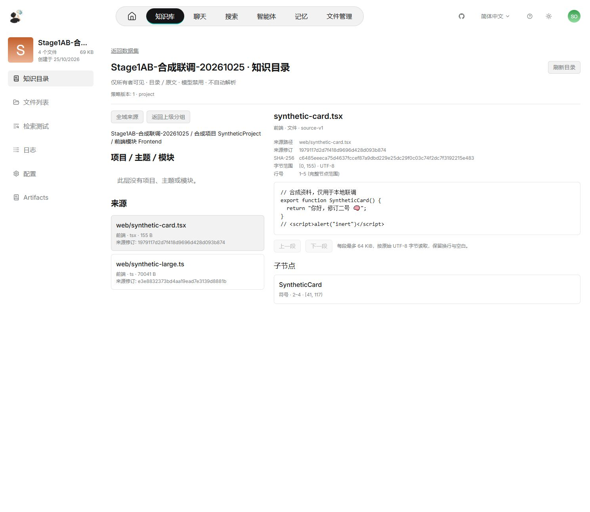

# 阶段1 A/B 接收与联调交接

日期：2026-10-25，Asia/Shanghai。接收分支：`codex/stage1ab-handoff`。**当前状态见第6节：真实联调工程闭环已完成，按用户授权合入main并推送，用户验收Pending。** 第1—5节保留`34fc8cb`接收轮次的事实；该轮只接收、核对和整理交接，未执行真实页面联调。

## 1. 已收到什么

| 项目 | 已核对事实 |
| --- | --- |
| A当前main基线 | `9bd92bab7be3664506abef83fbcae2846036bcac`，包含A阶段1修复及C2草案 |
| B代码提交 | `ee0b22efbd8695540fce37e93ed56999d3e9fde1` |
| B交付分支及记录 | `origin/codex/stage1b-catalogue`，交付头`e5db8d4`；[B交付说明](stage1b-delivery.md)、[B验证记录](stage1b-verification.json) |
| 分叉关系 | B基于A当前main，领先2个提交，main无独有提交；本轮未发现分叉或共享模型冲突 |
| B变动范围 | 20个文件，其中15个Web文件；其余为README、交付／验证文档和2张合成截图。后端、迁移、依赖锁、C1／C3及C2草案未改 |
| 当前工作树 | 已在本机独立接收分支检出B交付；未把B分支合入远端main，未覆盖B分支或改写其提交作者 |

B完成的是1B.1／1B.2的前端实现、真实接口客户端及消费者合成验证。B报告本身明确保留真实Go／MySQL／MinIO配合页面的联调、完整Dataset外壳／登录和整体阶段1退出。用户告知“B已经完成了第一阶段”，不能据此改写报告中尚未执行的工程事实。

## 2. A本机接收验证

| 检查 | A本次实测 | 边界 |
| --- | --- | --- |
| 交付源码 | 15个Web文件的工作区／Git blob SHA均与B交付清单一致 | 没有以相似文件名代替对应版本 |
| 契约与拥有边界 | C1／C3 1.0.0、C2 0.1.0-draft、Go后端、迁移和配置相对main均不变 | C2仍未冻结、未实现 |
| 格式和lint | 15文件oxfmt --check、oxlint通过 | 不格式化全仓，不修改共享UI组件 |
| 定向Jest | 2套29项通过 | 使用实际页面／hook／客户端与共享Schema，传输Mock；不代表真实页面联调 |
| 生产构建 | Vite生产构建通过，实测44.04秒 | 输出到被忽略的独立目录，没有覆盖现有web/dist、加载Web产物或替换容器 |
| 当前A后端 | 现有应用healthy；运行二进制SHA为`ce4d038cd36f179234976b7ae3eeb3b908e22c7c641765e5e593c1c432b9ea3e` | 沿用A修复后的服务；B无后端变动，本轮不重建Go |
| 全量类型检查 | 本轮未重跑 | B报告为207项既有错误、相对其基线完整诊断一致；这是B历史结论，本轮不冒充A重新验证，也不扩大修复范围 |
| 模型／真实资料 | 本轮模型推理调用0，未抓取／导入真实资料 | Jest传输Mock，未执行真实业务API或新建合成领域；不声称网络抓包证明 |

上述是一次接收验证，不是对抗性审查通过。原A第10轮Incomplete／审查Suspended与各次用户验收保持原范围。原始日志和隔离构建只在`.local-data/stage1ab-20261025`，不上传凭据或私有配置。

## 3. 现在怎么交接

通过同一GitHub仓库的分支和文档交换，不需要跨机后端地址、登录令牌、数据库或模型Key。B的现有交付分支保持原样；A的接收结果保存在本分支。

| 顺序 | A：本机生产／运行端 | B：页面消费端 | 可核对输出 |
| --- | --- | --- | --- |
| 1：固定版本 | 使用本分支及上述B代码，确认C1／C3 1.0.0和已加载A二进制 | 对照本回执；不另改领域模型、ID或生产契约 | 同一源码／契约和运行SHA |
| 2：加载并联调 | 在现有环境加载已验证Web产物；保留旧Web回退，使用同源/api及原登录链 | 暂不启动阶段2新页面；响应本闭环的消费问题 | 新页面确实来自当前构建，原服务／凭据／卷保留 |
| 3：合成闭环 | 按A交接创建合成私有域、project／module、文本来源和手工节点；禁止parse | 页面入口为`/dataset/knowledge-catalogue/{domain_id}`，从现有Dataset侧栏进入 | 域→项目／模块→来源→子节点→固定修订原文完整回读 |
| 4：必测交互 | 提供两主体及合成原文，核对真实HTTP、修订／SHA、字节范围和模型次数 | 若页面消费或布局失败，由B在拥有路径修复；不改共享UI库 | 中文／CRLF／空文件／超过64KiB分段、前后端标签、刷新／冲突／失败恢复、无权页面无正文 |
| 5：交付缺陷 | 若后端／契约失败由A修复并提供新的固定版本；不让B写临时字段绕行 | 若Web失败由B提供小提交与回归，A按同一闭环复验 | 具体请求／预期／实际、归属和提交；没有失败则不开展新一轮找问题 |
| 6：合入与阶段退出 | 保存脱敏的真实页面／HTTP证据，按35.8核对后合入同一main并推送 | 同步main，核对消费结果 | 工程联调结果与用户验收分开记录；本次接收回执不能替代用户决定 |

本轮没有执行步骤2—6，不能标记“真实页面已接通”或“整体阶段1已通过”。无权、错误／409及撤权后的缓存行为目前只有消费者合成证据；联调时记录实际结果，不用模拟结果补位。百万级性能、文档结构、代码关系、检索与MCP不进入本次联调范围。

## 4. 阶段2的下一次交接

阶段1真实闭环完成后，双方核对[技术方案第38章](../本地第二大脑知识库技术方案.md#38-v026-本机a阶段2启动准备c2来源任务草案)与[C2草案](knowledge-sources-v1.draft.schema.json)，B提交字段／状态／交互反馈，A统一落定完整请求接口与共享模型。B此前“没有生成C2客户端”不等于双方已确认C2。

B需要核对的六项：

1. registration_id／source_key／item_key与稳定Document／修订身份的区别；前后端标签逐项显示，标签不授予权限。
2. 预检、提交、幂等和冲突处理；根只用受控句柄，不在客户端拼服务器绝对路径。
3. saved、reference_only、catalogue ready、structure deferred及全文／向量disabled分别展示，禁止默认全量Embedding。
4. 逐项失败、partial_failed、重试、取消后已提交结果、分页和整体进度的表达。
5. 完整HTTP请求／响应／错误、创建状态码、预检TTL和幂等保留时长；当前draft未决定这些值。
6. 文档原件容量与修订投影、删除／撤销／旧版本保留；不通过放开阶段1受保护入口来实现。

双方核对后由A负责2A.1导入预检与受控保存，B负责2B.1导入表单／来源页面；2A.2增量与任务对应2B.2进度／失败／重试展示。实际知识域和首批受控目录仍须明确，不能把此前POC范围扩大成全仓或家庭资料。

## 5. 当前状态

- B前端交付：已接收，本机定向测试与隔离生产构建通过。
- A/B真实页面联调：Pending，由A现有运行环境承接，B负责其页面返修。
- B交付合入远端main：Pending；接收记录先在`codex/stage1ab-handoff`交换。
- 整体阶段1退出、用户验收：Pending。
- C2：DraftNotImplemented，未冻结；阶段2业务与阶段3—6未启动。

本回执更新接收状态，不回写B的原交付报告或A的历史验证数字；未向其他聊天、邮件或人员发送消息与凭据。

## 6. v0.28真实联调结果与B接续

本节替代第5节的当前Pending状态；不改写接收轮次的原报告。用户已授权真实联调和通过后合入main／推送，要求仅合成资料、禁模型、不启动多轮审查。

| 交接项 | 当前实际结果 |
| --- | --- |
| 源码／契约 | B代码仍`ee0b22e`，15文件与原清单SHA一致；C1／C3 1.0.0、C2 0.1.0-draft保持；没有应用代码修复或契约改动 |
| 本机加载 | B的1055构建文件已核对并原位复制到既有web/dist；现有同源Nginx连接原Go／MySQL／MinIO；原Go二进制、6服务、启动和挂载／卷不变 |
| 真实纵向闭环 | 原生登录→Dataset侧栏→知识目录→项目／前后端与文档模块→来源→父子节点→固定修订原文，17项浏览器检查通过 |
| 内容边界 | 155字节中文／emoji／CRLF；子节点[41,117)；0字节空文件；70041字节两窗口精确拼接；旧修订继续读旧字节，刷新读新修订 |
| 权限／模型 | 第二合成账号看不到域名、路径、节点或正文；未登录回登录页。六类模型策略拒绝、原生parse拒绝、任务0、新账号无模型凭据；旧6份／42块和配置／用量指纹不变 |
| 定向验证 | 11组真实API、29项消费者测试、15文件格式／lint通过；[Nginx脱敏轨迹](stage1ab-runtime-http.json)记录所选路由119请求，其中浏览器79、正文14。真实请求不等于消费者Mock |
| 历史证据 | B报告、A旧报告、接收JSON及共享契约共9文件SHA保持；原第10轮Incomplete／审查Suspended不变。新证据为[运行报告](stage1ab-runtime-verification.json) |

B的具体接续顺序：

1. 拉取main并从它新建短分支，确认包含B原提交与本轮报告；不回到旧官方镜像或另建后端。
2. 另一机器按[A→B构建说明](../阶段1-A-B交接说明.md#8-构建运行与回退)构建／加载当前Go和Web，再使用自己的原生账号和合成夹具。本机使用端口18080及现有挂载；Git pull不替代运行产物更新。开发代理使用该机器真实Go端口，不照搬A的私有路径或凭据。
3. 需要重现样本时，按C1示例创建合成私有域、shared项目、frontend／backend／non_code模块，上传TSX／Go／空Markdown和大文本，再登记来源与手工符号；不要parse。大文本由65535个ASCII `a`、`中`、CRLF、4462个`b`、CRLF及`// 大文件结尾 END-OF-SYNTHETIC`＋CRLF组成。小文件与坐标／SHA见报告及截图。A的实际ID仅供本机证据，不在B机器复用。
4. 只核对第4节六项C2消费问题，给出字段／状态反馈，由A统一完善请求和共享模型再冻结。阶段2业务、索引／检索、MCP、人格记忆继续按依赖推进，本轮没有开始。

运行／回退：A仅原位替换既有Web产物，并在受限忽略目录保留旧web/dist副本；回退时先复制旧资源，最后恢复旧入口，不改数据库或卷。两个合成测试账号与域留在A本机供复核，凭据仅在受限忽略目录；当前浏览器登录的是合成所有者，回到个人知识库时需切回原账号。不同机器不共享登录令牌或模型Key。

边界：阶段1纵向工程闭环通过，用户决定Pending；不存在“完整多轮审查通过”的新结论。409页面提示沿用B的消费者证据，本轮真实409在后端接口验证；断网／503／并发压力、全量类型检查和规模／检索质量没有重跑。合成原件变化由本地MinIO夹具设置后经真实C1发布，不能当作阶段2导入更新接口已实现。原生页面／测试通过不改变207项既有类型错误的历史状态。
