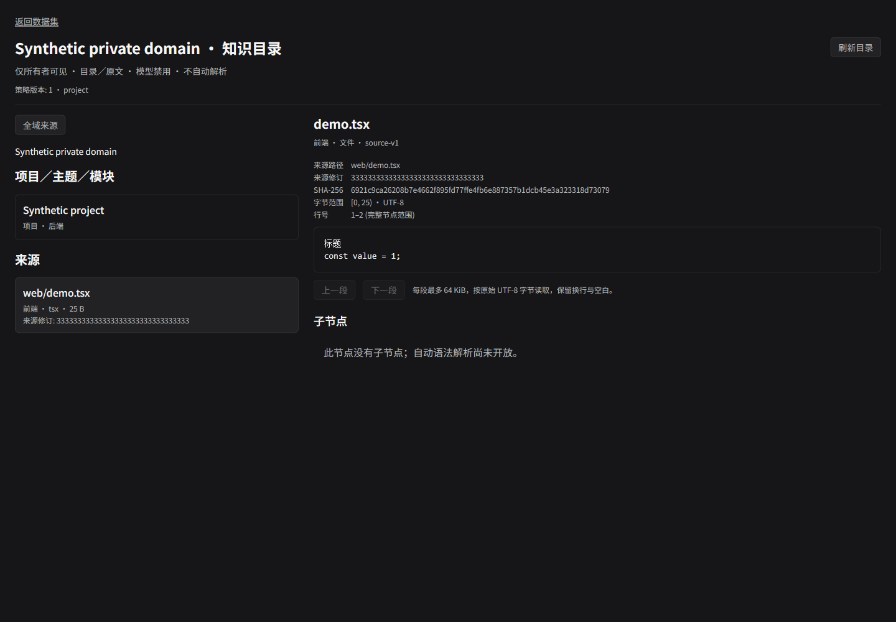
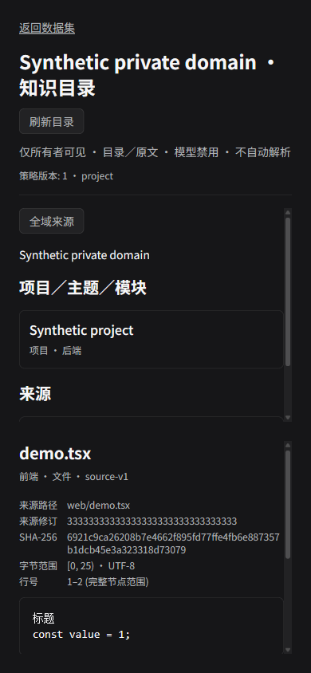

# 阶段1 B → A 交付与联调清单

日期：2026-10-25，Asia/Singapore。交付分支：`codex/stage1b-catalogue`。开发基线：`9bd92ba`，运行契约：C1／C3 `1.0.0`。本说明补充[阶段1 A → B 接续说明](../阶段1-A-B交接说明.md)，不改写A原有报告、历史审查状态或用户验收。

**B的页面、真实API客户端、消费者回归和生产构建已准备好；阶段1整体尚未退出。** 真实Go服务的一域→来源→节点→原文→页面回读仍待在A现有运行环境完成。本机没有A的`lfen-ragflow-poc`服务／卷，未借用其他应用的数据库、重建A的凭据或启动另一套领域后端。用户确认双方通过GitHub交换代码与交接记录，不提供跨机后端地址或登录令牌。

## 1. 本轮原话与逐项结果

| 原始要求／已确认边界 | 状态 | 证据与缺口 |
| --- | --- | --- |
| “本地现在所有都清掉……直接pull远端” | 活动开发树已恢复远端；临时依赖清理另记 | 本轮从远端main恢复，未复用旧独立Qdrant／CocoIndex实现；旧工具目录退出活动树。安装和验证缓存属于忽略的本机临时材料，不提交Git。 |
| “你是……B角色……并行开发” | 已执行 | 仅消费A的C1／C3；改动限Web、README及B交付证据；未改共享实体、DAO、API、迁移、OpenAPI或身份算法。 |
| “完成阶段一”——1B.1结构浏览／原文面板 | 实现完成，消费者验证通过 | Dataset侧栏新增“知识目录”；支持项目／主题／模块层级、来源、父子节点、原文和五类组件侧标签。原文按固定修订及UTF-8字节读取。完整运行环境的页面验收待下表联调。 |
| “完成阶段一”——1B.2真实C1／C3接入 | 客户端完成；真实服务回读待完成 | 生产页面使用既有axios认证链和真实API路径；29项测试替换传输层，不能代替真实MySQL／MinIO／Go API联调。 |
| “要交付并推送，另一边在等你” | 交付内容可核对，发布以远端分支为准 | 本文、Web源码、回归、结构化验证摘要和合成截图一起交付；Git推送结果在本轮回复中报告，不把本地commit视为已推送。 |
| “你们通过github上传下载来交流” | 已执行 | 使用独立分支和本文交接；未发送私聊、邮件、其他任务消息或共享凭据。 |
| 不提取AICS、不调用远程模型API | 已遵守 | 仅使用公开合成fixture；生产页面只有目录／原文GET，未增加解析、模型、上传、授权开关。工具链与依赖下载不是模型推理调用。 |
| 原始阶段1整体退出及用户验收 | 未完成 | 尚缺真实服务页面回读、双方证据核对及用户验收；阶段2业务和阶段3—6仍未启动。 |

## 2. 已交付行为与实现位置

- 页面入口：`/dataset/knowledge-catalogue/:id`，从现有Dataset侧栏进入；`:id`为原生`domain_id`，不创建新ID或第二套领域列表。未注册／无权／不存在都显示受限状态。
- `web/src/pages/dataset/knowledge-catalogue/`实现分组下钻／返回、来源选择、根／子节点、分页、刷新与固定修订原文。父级组件侧和来源组件侧分别显示；“共享”只是分类标签。
- `web/src/services/knowledge-foundation-service.ts`通过`registerNextServer`消费C1／C3，使用原生认证值，发送契约版本头；处理HTTP错误及HTTP 200非零code。没有业务内置Mock或数据库直连。
- `web/src/utils/knowledge-foundation-schema.ts`直接用共享OpenAPI的JSON Schema验证响应，不另写运行时契约。契约、结构或实际策略不受支持时停止展示正文。
- `web/src/hooks/use-knowledge-foundation.ts`使用统一query key factory；隔离登录会话、域、父级、修订、节点和字节窗口。取消旧请求；重新授权失败后隐藏已展示的旧数据。
- 单次原文窗口≤65,536字节；UTF-8末端被服务拒绝时最多收缩3字节，共4次尝试。下一段从实际响应末端继续，不使用JS字符索引。显示来源路径、修订ID、SHA、字节范围与完整节点行号；保留CRLF、空白，按纯文本展示HTML。
- 没有新增来源导入、AST自动解析、关系边、检索、模型用途、模块Grant或临时MCP Key。C2的`0.1.0-draft`不是可调用接口，本分支没有生成C2生产客户端。

## 3. 执行与验证

结构化摘要、文件SHA及诊断比较见[验证记录](stage1b-verification.json)。本机工作目录中的依赖被占用，因此通过`npm ci --no-audit --no-fund`在独立临时目录安装锁定依赖，并复制公开源码验证；交付源码与验证副本逐文件比对SHA。没有复制根`.env.local`、私有Compose或运行凭据。

| 检查 | 实际结果 | 限定范围 |
| --- | --- | --- |
| oxfmt及`--check` | 15个变动Web文件通过 | 仅本轮文件，不格式化整个应用。 |
| oxlint | 通过，无新增警告 | 同上。 |
| 定向Jest | 2套、29项通过 | 实际页面／hooks／客户端／共享Schema，Mock仅在传输层；覆盖层级、字节边界、CRLF、空文件、无权、重试、冲突、分页、纯文本、修订校验、撤权后隐藏旧内容。 |
| `tsc --noEmit` | 全量失败，207处 | 在`9bd92ba`对照与本分支中，去除行列号后的**完整诊断文本一致**；本轮文件无类型错误。未把基线错误修复算入本轮。 |
| Vite生产构建 | 通过 | `VITE_BUILD_SOURCEMAP=false VITE_MINIFY=esbuild NODE_OPTIONS=--max-old-space-size=8192 npm run build`；保留既有分块体积和Tailwind提示。 |
| 浏览器视觉检查 | 合成响应下通过 | 单独挂载实际知识目录视图，中文、1440×1000与390×844；可见原文／修订／组件侧。不是原生登录／完整Dataset外壳／真实存储联调。 |
| A基线源码本机构建 | C++与Go构建、四模式帮助启动通过 | 使用原`build.sh`，Go 1.27.3、Clang／LLD 20.1.2、CMake 4.4.4；挂载盘首轮20秒超时后，同一二进制在WSL ext4上验证api／admin／ingestor／syncer帮助输出，按main约定退出1。不提交二进制或改动构建脚本；未部署服务。 |
| 真实服务纵向闭环 | **待完成** | 本机未运行A的POC；本轮没有用模拟回读冒充该项。 |

截图只含公开合成资料，不含真实AICS内容或登录／模型凭据。视觉检查使用本机临时HTML入口、原组件和受限的合成HTTP响应；这些临时入口未进入产品或仓库。

## 4. A拉取后的最短联调顺序

1. 拉取`origin/codex/stage1b-catalogue`，核对文件范围及C1／C3 1.0.0，再合入当前工作分支。保留A已加载的修复后二进制；旧官方镜像不能证明包含新接口。
2. 在`web`执行`npm ci --no-audit --no-fund`，运行上述定向Jest及生产构建。原Vite代理仍指向本机Go API 9380／Admin 9381；若使用A已有19380端口，先在本机对齐端口映射或反向代理。生产构建使用同源`/api`，不在客户端硬编码A机地址。
3. 使用A本机原生登录身份，按A接续说明创建**合成**私有空数据集并登记为领域，创建project／module，multipart上传UTF-8文本／代码，再登记来源。不得启动parse或传模型配置；需要子层级时显式创建手工节点。
4. 打开Dataset→知识目录，逐级选中来源／节点；核对domain、parent、source_revision、node、SHA及原文。验证中文、CRLF、空文件和超过64KiB的分段。记录所用Git提交、实际服务二进制SHA和前端构建版本。
5. 用第二个原生账号核对404隐藏与页面无正文；核对错误／409刷新恢复及不产生模型、解析、检索请求。不得传A的令牌给B，也不把原生API Key当临时共享Key。
6. 将脱敏的真实HTTP／页面结果提交GitHub，再核对阶段1退出标准并请用户验收。A原有API单侧通过和B本次合成回归都不能独立代替该步骤。

## 5. 剩余项与接续边界

- **真实页面回读／联合验收：Pending。** 尚无本分支前端配合真实Go服务的一域→来源→节点→原文→页面证据。
- **用户验收：Pending。** 不沿用阶段0验收或A旧工程报告，推导阶段1已验收。
- **全量类型检查基线：207处既有错误。** 本轮没有扩大处理范围；不能报告全仓类型检查通过。
- 本机残留的占用依赖和临时构建／视觉材料只在忽略目录，退出活动源码；没有提交或推送这些材料。不得用全局`git clean -fdx`清理正在使用的运行配置、卷或凭据。
- C2反馈与阶段2实现等阶段1真实闭环后推进；不修改此前七项原话、历史49项任务、完整验收标准或Suspended审查的范围。
