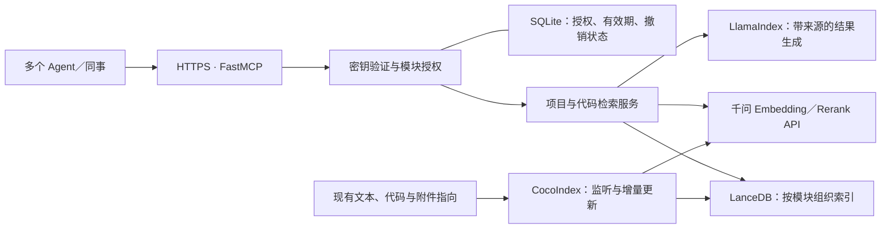
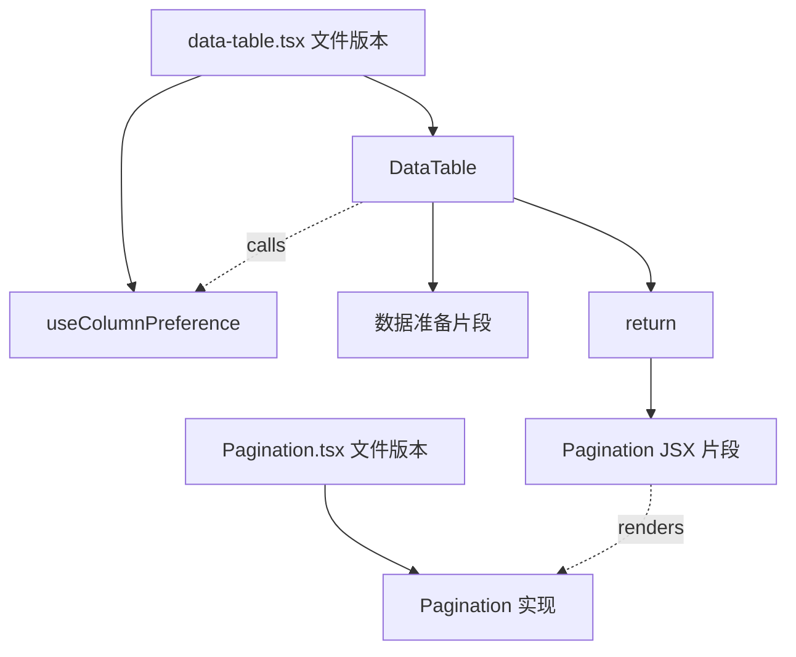

# 会话副本：调研知识库开源框架

- 导出时间：2026-10-21 17:57（Asia/Shanghai）。
- 原会话 ID：`01a158c6-4366-7792-8768-4aed0b80a6a4`。
- 来源：Codex `read_thread` 分页导出，已读取至 `hasMore=false`，共 17 轮、23 条用户消息、76 条助手回复。
- 范围：用户正文（包括异步问答）和助手的进度、最终回复；不包含工具日志、内部推理、浏览器环境注入或密钥。
- 各轮标注的是轮次开始时间，不能作为轮内每条消息的精确发送时间。此副本截止本次 Git 推送任务的早期进度，最终提交和推送结果见 Git 历史及本次交付回复。
- 这是供阅读和接续开发的文本副本，不是可导入 Codex 并恢复会话状态的原生备份。旧回复保留历史观点；当前基线以 [技术方案](本地第二大脑知识库技术方案.md) 和 [接续说明](会话接续说明.md) 为准。
- 历史中的本机路径、截图链接和额度是当时记录；附件与工具输出不属于正文导出。额度截图另保存为仓库根目录 `moark-stage0-trial-quota-94.png`。

## 第 1 轮 · 2026-10-20 18:05:52 +08:00

### 用户

我将在本机构建我的知识库，即我的第二大脑，知识库内容现在初始定位只有文本文件，顶多有附属的照片或者其他文档，但是只对附件做对应的指向，而不做向量化，知识库初始的目标做混合检索，重排，结果生成，然后提供给类似codex这样的智能体或者其他agent，并且能够即时增添新的内容到知识库中，知识库将包含日常常识积累，灵感，日记，我的项目代码经验，项目模板库，优质代码案例模板，优质网页资源等内容，主要是项目和代码相关的内容，比如我要将我的一个项目知识库化，那后续我就可以直接在新项目复用这个知识库中的现成代码，稍加修改或者适配即可使用

你需要先去github找一下最适配的开源框架，比如混合检索技术，重排技术等
至于向量化工具，我推荐使用千问的模型，那个8B的小模型

现在，我们从先找到一系列可以借鉴的高质量开源框架开始吧

---

### 助手 · 进度

本次任务使用 skills：无。先检索 GitHub 上适合本地文本知识库的开源项目，重点核查混合检索、重排、代码复用、增量索引和 Agent 接入，并确认你提到的千问 8B 模型。

---

### 助手 · 回复

为判断千问 8B 在本机的运行方案，请补充 GPU 型号与显存、内存容量，以及预计知识库规模（文件数或总容量）；暂时没有估计也可以，我会先完成框架调研。

---

### 助手 · 进度

已找到一个贴近目标的项目：QMD 已集成本地混合检索、重排和 MCP，当前版本还支持按函数、类切分代码。正在核查中文检索、千问模型替换和增量更新的边界；这些能力决定它能否直接作为底座。

---

### 用户

<send_user_message_question_reply>
[{"questionItemId":"[\"request_user_input_async\",\"call_c3fb83b8afaa4fc79e4e588deb7ff80f\",0]","question":"为判断千问 8B 在本机的运行方案，请补充 GPU 型号与显存、内存容量，以及预计知识库规模（文件数或总容量）；暂时没有估计也可以，我会先完成框架调研。","answer":"先完成框架调研吧，至于embading模型，我用千问的api"}]
</send_user_message_question_reply>

---

### 助手 · 进度

按千问 Embedding API 继续筛选。这个条件会改变推荐顺序：QMD 官方文档以本地 GGUF 模型为主；能接入远程 Embedding API 的模块化框架更贴合你的方案。原文和索引仍可保存在本机，待向量化的文本会发送到 API 服务商。

---

### 助手 · 进度

核心候选已收敛：LlamaIndex 负责接入与检索编排，LanceDB 适合个人本地存储，Qdrant 是独立服务方案的备选。另一个关键区别是：RRF 负责合并两路召回结果；要满足你要求的模型重排，还需接独立 Reranker。代码部分会重点借鉴 CocoIndex 的增量索引和代码切分。

---

### 助手 · 回复

本次任务使用 skills：无。

**首轮调研建议：以 LlamaIndex + LanceDB + 千问 Embedding API + 独立重排模型 + MCP 为优先验证组合。** QMD 值得借鉴完整检索流程，CocoIndex 值得借鉴增量更新，CocoIndex Code 值得借鉴代码索引。

核验日期：**2026-10-20**。以下依据 GitHub 仓库、官方文档与关键集成源码；属于适配判断，尚未进行本机部署和效果实测。

**一、优先研究的开源项目**

| 项目 | 定位 | 已核实的相关能力 | 对你的适配判断 |
|---|---|---|---|
| [LlamaIndex](https://github.com/run-llama/llama_index) · MIT | 知识库开发框架 | 文档解析、代码切分、Embedding 接入、检索、重排与结果生成编排 | **主框架首选**。适合组合现有组件，构建自己的知识库接口 |
| [LanceDB](https://github.com/lancedb/lancedb) · Apache-2.0 | 本地嵌入式检索存储 | 向量检索、BM25 全文检索、混合查询、结果融合及重排扩展 | **个人本地存储首选候选**。无需单独维护数据库服务 |
| [Qdrant](https://github.com/qdrant/qdrant) · Apache-2.0 | 独立检索数据库 | 稠密与稀疏向量、元数据过滤、多阶段查询、RRF/DBSF 融合 | **服务化方案备选**。适合多个 Agent 共用一个检索服务 |
| [Haystack](https://github.com/deepset-ai/haystack) · Apache-2.0 | 检索与生成流水线框架 | 通过组件显式连接召回、融合、重排、生成及路由 | **主框架备选**。适合需要清晰控制、调试每个检索阶段的实现 |
| [QMD](https://github.com/tobi/qmd) · MIT | 本地知识检索工具 | BM25、向量检索、查询扩展、RRF、模型重排、CLI、MCP；当前主分支支持代码 AST 切分 | **完整检索实现参考**。与你的使用场景接近，但远程 Embedding API 接入需核查 |
| [CocoIndex](https://github.com/cocoindex-io/cocoindex) · Apache-2.0 | 增量索引引擎 | 根据输入及处理逻辑的变化更新目标数据，缓存未变化的计算 | **增量更新重点参考**。研究如何减少重复切分和 API 向量化调用 |
| [CocoIndex Code](https://github.com/cocoindex-io/cocoindex-code) · Apache-2.0 | 面向 Agent 的代码搜索工具 | AST 切分、增量索引、远程 Embedding、MCP；返回代码、路径与行号 | **代码知识库重点参考**。官方检索入口以语义搜索为主，不能直接视为完整混合检索方案 |
| [MCP Python SDK](https://github.com/modelcontextprotocol/python-sdk) · MIT | Agent 接口开发工具 | 官方 MCP 服务端与客户端 SDK | **接口层候选**。用于暴露搜索、读取原文、添加内容等工具；检索逻辑需要自己实现 |
| [RAGFlow](https://github.com/infiniflow/ragflow) · Apache-2.0 | 完整知识库产品 | 文档处理、知识库管理、检索与生成、Agent 工作流 | **产品设计参考**。可研究管理界面与检索调试；其部署起始配置高于嵌入式方案 |

这些项目分属不同层级：LlamaIndex/Haystack 负责流程，LanceDB/Qdrant 负责存储检索，CocoIndex 负责增量处理，MCP SDK 负责对外接口。

**二、影响选型的四个关键发现**

**1. 使用千问 API 后，LlamaIndex 比 QMD 更适合作为当前主线**

LlamaIndex 已提供 `OpenAILikeEmbedding`，可配置模型名、API 地址、批大小和向量维度，也有 DashScope 集成。接入哪一类适配器，取决于你实际使用的 API 服务商。[兼容接口源码](https://github.com/run-llama/llama_index/blob/main/llama-index-integrations/embeddings/llama-index-embeddings-openai-like/llama_index/embeddings/openai_like/base.py)、[DashScope 集成文档](https://developers.llamaindex.ai/python/framework/integrations/embeddings/dashscope_embeddings/)

QMD 当前官方文档主要采用 `node-llama-cpp + GGUF` 本地模型；仓库中仍有远程兼容接口的功能请求。因此，**本轮将 QMD 定为流程与源码参考，不将其列为千问 API 已开箱兼容的方案**。[QMD 文档](https://github.com/tobi/qmd)、[远程模型接口讨论](https://github.com/tobi/qmd/issues/620)

**2. LanceDB 已覆盖混合检索，但中文分词需要明确配置**

LanceDB 官方支持向量与全文混合查询；全文索引文档提供了中文 Jieba 分词配置，并说明需要对应的分词模型文件。LlamaIndex 也已有 LanceDB 混合查询集成。[混合检索文档](https://docs.lancedb.com/search/hybrid-search)、[中文分词文档](https://docs.lancedb.com/search/full-text-search)、[LlamaIndex 集成](https://developers.llamaindex.ai/python/framework/integrations/vector_stores/lancedbindexdemo/)

你的验证样本需要同时包含：中文描述、英文技术术语、函数名、文件路径和报错码。它们对分词与召回的要求不同。

**3. RRF 融合与模型重排是两个阶段**

RRF 根据两路召回结果中的名次合并列表；模型重排会重新评估“问题与候选内容”的相关性。LanceDB 将默认融合器命名为 `RRFReranker`，但它不能替代你要求的独立模型重排。[LanceDB 官方说明](https://docs.lancedb.com/search/hybrid-search)、[Qdrant 融合说明](https://qdrant.tech/documentation/search/hybrid-queries/)

因此应验证的链路是：

**BM25 召回 + 向量召回 → RRF 融合 → Reranker 重排 → 原文提取／结果生成。**

**4. 增量索引不等于文件保存后立即可检索**

LlamaIndex 的 `IngestionPipeline` 配合文档存储，可以通过文档 ID 与内容哈希跳过未变化内容，并更新发生变化的文档；文件监听、任务触发、删除同步仍需要系统接好。[增量文档管理说明](https://developers.llamaindex.ai/python/framework/module_guides/loading/ingestion_pipeline/)

CocoIndex 值得重点研究这一层；CocoIndex Code 则展示了“查询前刷新索引”和“返回代码位置”的具体实现。[CocoIndex](https://github.com/cocoindex-io/cocoindex)、[CocoIndex Code](https://github.com/cocoindex-io/cocoindex-code)

**三、千问模型与重排候选**

你最初提到的 8B，若指该系列，其名称是 **Qwen3-Embedding-8B**。该系列还有 0.6B、4B；Embedding 与 Reranker 是分别训练、承担不同任务的模型。[千问官方仓库](https://github.com/QwenLM/Qwen3-Embedding)

| 用途 | 优先研究对象 | 注意点 |
|---|---|---|
| 文本与代码向量化 | 千问 Embedding API | 供应商实际提供的 `model_id`、输入限制和输出维度需要单独确认 |
| 召回后的模型重排 | Qwen3-Reranker 系列，或供应商提供的重排 API | 不能直接用 Embedding 接口代替 |
| 重排效果对照 | [FlagEmbedding](https://github.com/FlagOpen/FlagEmbedding) 中的 BGE Reranker | 可作为中文与多语言检索的对照候选 |

阿里云目前另有 `qwen3-rerank` API；它是服务端模型名称，不能直接认定与开源 8B 权重完全相同。具体可用模型与接口取决于服务区域。[官方重排 API](https://www.alibabacloud.com/help/en/model-studio/rerank)

**四、针对代码复用，建议重点借鉴什么**

“项目知识库化”需要检索结果保留足够的复用依据。建议重点研究以下能力：

| 内容 | 应保留的信息 |
|---|---|
| 代码片段 | 原始代码、文件路径、行号、所属函数或类 |
| 项目来源 | 仓库、分支或提交版本 |
| 适配条件 | 框架版本、依赖、配置要求、使用限制 |
| 关联内容 | 调用示例、测试、设计说明、经验总结 |
| 附件 | 文件路径或链接，与正文的关联关系 |

代码切分可借鉴 LlamaIndex 的 `CodeSplitter` 和 CocoIndex Code；函数、类、导入语句的结构解析可进一步研究 [Tree-sitter](https://github.com/tree-sitter/tree-sitter)。这些工具提供解析与索引能力，复用元数据仍需你自己的知识库规范。[CodeSplitter 文档](https://developers.llamaindex.ai/python/framework/module_guides/loading/node_parsers/modules/)

给 Agent 的结果应包含**可读取的原文和代码位置**；生成的说明与摘要作为附加结果，方便 Agent 核对并适配。照片和其他附件按你的范围只保存关联指向。

**建议优先深入的五个仓库：LlamaIndex、LanceDB、QMD、CocoIndex、CocoIndex Code。** 后续确定千问 API 的服务商与 `model_id` 后，就能进一步收敛接入方案、重排方式和增量索引实现。

---

## 第 2 轮 · 2026-10-20 18:14:49 +08:00

### 用户

继续深入研究这五个仓库，重点确认千问 API 接入、中文和代码混合检索、增量更新及 MCP 接口，明确哪些能直接用、哪些需要改造，给我一套具体的技术组合方案，先不写代码。
注意，要特别找那种适合项目和代码检索的，另外，我后续接入的agent可能有多个，并且还需要根据不同的知识库模块去设置MCP的接入权限，比如我这个知识库只给我的同事访问一小块内容，给他一把临时的钥匙即可

---

### 助手 · 进度

本次任务使用 skills：无。继续核查这五个仓库的文档与源码，重点确认代码检索、千问 API、增量更新，以及多 Agent 和临时密钥的权限控制；本轮只给技术方案，不写代码。

---

### 助手 · 进度

已确认：CocoIndex 有官方的代码索引和 LanceDB 增量同步示例，可用于减少重复向量化。权限方面，知识库筛选参数不能替代访问控制；同事的临时密钥需要由服务端强制限定可访问模块，搜索、原文读取和附件访问都要执行同一授权规则。

---

### 助手 · 进度

源码里发现了一个会影响中文检索的接口差异：CocoIndex 的 LanceDB 连接器只暴露 `language` 等少量全文索引参数；LanceDB 真正的中文分词还需配置 `base_tokenizer`。LlamaIndex 的现成集成也会按默认参数创建全文索引。因此方案会增加一层索引适配，明确管理中文分词、代码标识符和权限过滤。

---

### 助手 · 回复

本次任务使用 skills：无。

**建议采用：CocoIndex 增量索引 + LanceDB 混合检索 + 千问 Embedding／Rerank API + FastMCP 共享服务 + SQLite 权限管理。LlamaIndex 负责结果生成；QMD、CocoIndex Code 作为实现参考。**

需要调整上一轮的主次：**代码与项目检索由自己的检索服务控制，CocoIndex 承担索引更新，LlamaIndex 保持为可替换的编排组件。** 模块授权、临时密钥和代码上下文组装，需要在这五个仓库之外补齐。

核验日期为 **2026-10-20**。本轮检查了发布版本、文档和关键源码，未安装、修改文件或进行效果实测。

**一、五个仓库：哪些可复用，哪些需要改造**

“可直接复用”指已有组件可调用、配置，不代表整个知识库已经开箱可用。

| 仓库与核查版本 | 可直接复用 | 需要补齐的部分 | 建议用途 |
|---|---|---|---|
| [LlamaIndex v0.14.25](https://github.com/run-llama/llama_index/tree/v0.14.25) | Embedding 接口适配、文档处理、检索与生成编排 | 代码专用召回、索引参数、模块授权、临时密钥 | 结果生成与通用组件 |
| [LanceDB v0.40.0](https://github.com/lancedb/lancedb/tree/v0.40.0) | 向量、BM25、RRF、中文分词配置、元数据过滤 | 代码标识符处理、索引生命周期、服务端授权 | **主要检索存储** |
| [QMD v2.8.3](https://github.com/tobi/qmd/blob/v2.8.3/README.md) | 本地混合检索、重排、代码 AST 切分、CLI、HTTP/stdio MCP | 千问远程 API、多人身份、模块权限、密钥生命周期 | 检索流程参考 |
| [CocoIndex v1.0.25](https://github.com/cocoindex-io/cocoindex/tree/v1.0.25) | 文件监听、缓存、增量处理、删除同步、LanceDB 写入 | 项目元数据、中文与代码索引配置、模型接入策略 | **主要索引引擎** |
| [CocoIndex Code v0.2.42](https://github.com/cocoindex-io/cocoindex-code/tree/v0.2.42) | AST 代码切分、远程 Embedding、增量索引、路径和行号输出、stdio MCP | BM25、模型重排、共享 HTTP 服务、模块权限 | 代码索引参考 |

这五者的已核查接口，**均不能直接完整提供“同事持临时密钥，仅访问指定模块”的共享服务**。

有三个决定性的源码发现：

- **QMD 的远程模型接口尚不能按正式功能采用。** OpenAI 兼容后端 PR #619 仍未合并；其 HTTP 文档也明确说明接口没有身份鉴权。Collection 筛选不能当作访问权限。[PR #619](https://github.com/tobi/qmd/pull/619)、[HTTP 接口说明](https://github.com/tobi/qmd/blob/v2.8.3/README.md)
- **中文分词存在连接器参数缺口。** CocoIndex 的 LanceDB 连接器暴露 `language`、`with_position`，而 LanceDB 明确说明：`language` 用于词干和停用词处理，启用中文分词需要 `base_tokenizer` 等配置。仅设置 `language="Chinese"` 不足以确认中文检索正确。[CocoIndex 连接器源码](https://github.com/cocoindex-io/cocoindex/blob/v1.0.25/python/cocoindex/connectors/lancedb/_target.py)、[LanceDB FTS 配置源码](https://github.com/lancedb/lancedb/blob/v0.40.0/python/python/lancedb/index.py)
- **CocoIndex Code 是语义代码搜索工具。** 核查版本使用 SQLite 向量检索，路径筛选走距离计算查询；MCP 入口运行 stdio。它适合借鉴代码处理，直接改成你的完整共享知识库，需要补建主要服务层。[查询源码](https://github.com/cocoindex-io/cocoindex-code/blob/v0.2.42/src/cocoindex_code/query.py)、[MCP 源码](https://github.com/cocoindex-io/cocoindex-code/blob/v0.2.42/src/cocoindex_code/server.py)

**二、具体技术组合**

| 层级 | 选定方案 | 职责 |
|---|---|---|
| 原始资料 | 保留现有文本文件、代码仓库和附件 | 原文作为权威来源；通过注册表映射逻辑模块，不要求移动文件 |
| 索引处理 | CocoIndex | 监听变化、切分、缓存向量化结果、更新和删除索引 |
| 代码解析 | CocoIndex 的 Tree-sitter 切分，加项目元数据提取 | 识别代码结构、位置、符号及关联说明 |
| 检索存储 | LanceDB OSS | 保存文本块、向量、全文索引与过滤字段 |
| 检索逻辑 | 自建薄服务层 | 权限裁剪、精确查询、混合召回、重排、上下文组装 |
| 模型调用 | 统一千问 API 适配层 | 统一入库与查询模型配置、批次、重试和用量 |
| 结果生成 | LlamaIndex | 生成带来源的解释；同时保留原始代码与引用 |
| Agent 接口 | [FastMCP](https://github.com/PrefectHQ/fastmcp) 的 Streamable HTTP | 多客户端连接、身份上下文、工具权限检查 |
| 权限存储 | SQLite | 凭据、模块授权、操作权限、到期时间、撤销与审计 |

**CocoIndex 负责写索引，检索服务负责读索引。** 多个 Agent 共用这套服务，不为每个 Agent 重复建立完整索引。

CocoIndex 已有官方代码索引和 LanceDB 示例，包含代码位置、实时监听与增量同步；示例默认使用通用英文模型，需要替换模型和补充项目字段。[代码与 LanceDB 示例](https://github.com/cocoindex-io/cocoindex/blob/v1.0.25/examples/code_embedding_lancedb/main.py)

**三、中文与代码检索的具体设计**

建议采用三路召回，满足“中文找实现”和“准确找符号”两类需求。

| 召回方式 | 处理对象 | 示例 |
|---|---|---|
| 精确／结构化查询 | 函数名、类名、路径、配置项、依赖版本 | `createAuthMiddleware`、`src/auth/session.ts` |
| BM25 全文检索 | 中文说明、注释、技术术语、报错文本 | “登录态刷新”、特定错误码 |
| 千问向量检索 | 意图相近、措辞不同的实现与经验 | “找一个支持取消请求和重试的接口封装” |

具体处理规则：

1. **中文正文与代码标识符分开准备检索字段。** 中文字段配置 Jieba 分词；标识符同时保存原始形式和拆分形式，例如 `getUserProfile` 与 `get user profile`。
2. **代码检索字段关闭词干处理与停用词删除，并检查长标识符限制。** LanceDB 默认会忽略超过一定长度的 token，不能直接沿用普通文章索引参数。[全文索引配置](https://github.com/lancedb/lancedb/blob/v0.40.0/python/python/lancedb/index.py)
3. **精确符号命中单独保留。** BM25 与向量结果通过 RRF 融合，再交给 Reranker；准确的符号查询不依赖重排模型决定是否保留。
4. **按查询补充上下文。** 返回匹配函数后，再读取获授权的导入、类型定义、测试和使用说明。
5. **区分源码、经验和模板。** 支持按项目、语言、框架、版本、内容类型筛选，避免把旧项目实现直接当作通用模板。

可作为首轮评测起点的参数：BM25 与向量各召回 40 条，合并去重后最多重排 60 条，返回 8 条。**这些是待验证的初始配置，不是性能或效果承诺。**

每条代码结果至少包含：

- 项目、逻辑模块、仓库相对路径、起止行号。
- 原始代码、符号名称、语言。
- Git 提交版本；未提交内容另记文件哈希与修改状态。
- 框架及依赖要求、关联测试、复用说明。
- 索引时间与内容版本。

Tree-sitter 提供语法结构，**不能单独保证依赖解析完整，也不能保证代码复制后即可运行**。项目说明、依赖和测试应作为关联知识一并检索。

**四、千问 API 与增量更新**

千问 API 的接入能力已经确认，但需要区分两种服务：

| API 来源 | 接入判断 |
|---|---|
| 阿里云百炼 | 有兼容 Embedding 接口和 DashScope 原生接口；原生接口还提供 query/document 类型与任务指令 |
| 托管开源 Qwen3-Embedding-8B 的供应商 | 按其模型名称、协议、批次和维度限制接入，不能直接套用百炼参数 |

LlamaIndex 已有可配置模型名和地址的 Embedding 适配器；CocoIndex 的 `LiteLLMEmbedder` 支持自定义后端、请求重试、批处理及缓存。[LlamaIndex 适配器](https://github.com/run-llama/llama_index/blob/main/llama-index-integrations/embeddings/llama-index-embeddings-openai-like/llama_index/embeddings/openai_like/base.py)、[CocoIndex 模型调用源码](https://github.com/cocoindex-io/cocoindex/blob/v1.0.25/python/cocoindex/ops/litellm.py)

接入层仍需处理两个具体差异：

- **批次限制：** CocoIndex 默认批处理上限为 64 条；百炼 `text-embedding-v4` 文档上限为每批 10 条，需要明确切批策略。
- **模型规格：** 百炼 API 模型名称、输出维度和输入限制不能直接等同于开源 8B 权重；入库和查询必须使用同一套模型及向量配置。[百炼官方接口](https://www.alibabacloud.com/help/zh/model-studio/text-embedding-synchronous-api)

增量更新建议这样运行：

| 变化 | 系统行为 |
|---|---|
| 新增文件 | 切分并向量化新增内容 |
| 修改文件 | 重新切分；相同输入复用已有向量结果 |
| 移动、重命名 | 更新来源关系；相同向量化输入复用缓存 |
| 删除文件 | 清理对应检索记录 |
| 修改共享权限 | 立即改变授权结果，不重新向量化 |
| 更换模型、维度或向量化规则 | 建立新索引版本并重建受影响向量 |

CocoIndex 已提供缓存和增删同步能力。[增量同步说明](https://cocoindex.io/docs/examples/text-embedding-lancedb/)

还需补齐两个运行细节：

- **多个读取进程刷新版本。** LanceDB 默认连接不检查其他进程的更新；查询服务应配置读取一致性，确保能看到索引工作进程的新提交。[连接源码](https://github.com/lancedb/lancedb/blob/v0.40.0/python/python/lancedb/db.py)
- **全文索引维护。** 新行在优化前通过未索引数据扫描保持结果完整；后台执行 `optimize()`，即时检索路径不启用跳过新数据的 `fast_search()`。[全文索引更新说明](https://docs.lancedb.com/search/full-text-search)

“保存后即时可检索”应定义为**异步更新完成后可检索**，延迟包含 API 调用时间。新增接口返回任务 ID 和索引状态，避免把“文件已保存”误报为“索引已更新”。

**五、多 Agent、模块权限与临时钥匙**

建议采用：**每个接入方独立凭据，凭据绑定模块集合、操作集合和有效期。**

例如，给同事的临时授权：

| 授权项 | 示例 |
|---|---|
| 持有人 | 同事 A |
| 接入标识 | 同事 A 的开发 Agent |
| 可访问模块 | 项目 A 的共享 UI、网页模板库 |
| 操作 | 搜索、读取代码与说明 |
| 有效期 | 8 小时 |
| 写入 | 未授权 |
| 撤销 | 管理端随时撤销，后续请求失效 |

“一小块内容”建议建立为**逻辑共享子模块**。它可以映射现有目录、指定文件或独立知识项；授权共享子模块不会自动获得父项目权限。

服务端必须统一执行以下规则：

1. **先验证密钥，再确定允许访问的模块。** 请求中的模块条件只能缩小授权范围。
2. **召回前限制范围。** 精确查询、BM25 和向量查询全部受相同授权约束；重排和生成只接收授权内容。LanceDB 支持将过滤应用于混合检索两路查询。[过滤文档](https://docs.lancedb.com/search/filtering)
3. **读取原文再次鉴权。** 知道文档 ID、文件名或旧搜索结果，不代表仍有读取权限。
4. **上下文扩展继续鉴权。** 导入、测试和附件位于其他模块时，逐项检查；不自动扩大访问范围。
5. **缓存绑定授权范围与版本。** 不在不同权限的 Agent 之间复用包含私有内容的答案。
6. **每次请求检查到期与撤销。** 已建立的 MCP 会话也不能绕过检查。

临时钥匙建议采用高随机性的 **opaque Bearer token**，服务端只保存其哈希与授权记录。发放后可直接撤销，权限变更无需更换整套知识库索引。

FastMCP 已提供 TokenVerifier 扩展和工具级权限检查；**密钥签发、模块授权表、到期撤销与数据过滤仍由自己的服务实现**，不使用文档中仅供开发测试的明文静态密钥配置。[令牌验证文档](https://gofastmcp.com/servers/auth/token-verification)、[授权文档](https://gofastmcp.com/servers/authorization)

这里有三个实际边界：

- 手工发钥匙的方案适用于能配置 HTTP Bearer Header 的客户端；它不等同于完整 OAuth 登录。只支持 OAuth 自动发现的客户端，需要补授权服务器。[MCP 授权规范](https://modelcontextprotocol.io/specification/2026-07-28/basic/authorization)
- Bearer 钥匙识别的是凭据持有人；一把钥匙被多人共用时，无法可靠区分实际操作者。因此不同接入方分别发钥匙。
- 到期和撤销可阻止后续访问，无法收回已经复制的内容。同事远程访问时，本机服务必须在线且网络可达。

**六、建议暴露的 MCP 工具与改造范围**

以下是建议设计的接口名称，尚未实现：

| 工具 | 作用 | 授权要求 |
|---|---|---|
| `list_modules` | 列出可访问模块 | 仅返回已授权模块 |
| `search_code` | 检索代码、模板和实现案例 | 模块搜索权限 |
| `search_knowledge` | 检索经验、文档、灵感等 | 模块搜索权限 |
| `get_context` | 读取命中片段与关联上下文 | 逐项读取权限 |
| `get_reuse_bundle` | 返回代码、测试、依赖和适配说明 | 每个关联项分别鉴权 |
| `get_attachment` | 获取获授权附件 | 独立附件读取权限 |
| `add_content` | 保存新内容并提交索引任务 | 指定模块写入权限 |
| `answer` | 生成带来源的解释与建议 | 限定在授权证据内 |

最终需要开发的是四块业务适配：

- **索引适配：** 中文分词、代码字段、稳定 ID、项目版本与来源信息。
- **检索适配：** 精确查询、混合召回、模型重排、复用上下文组装。
- **共享权限：** 临时密钥、模块授权、撤销、配额与审计。
- **MCP 封装：** 将上述能力暴露给多个客户端，并让全部读写入口执行相同授权。

建议通过外部适配层完成这些工作，复用五个仓库的组件，避免维护大型框架分叉。

后续选型仍缺三项信息：**千问 API 服务商及模型名、需要接入的 Agent 列表、同事访问的网络范围。** 它们分别决定模型适配、Bearer／OAuth 接入方式和 HTTPS 部署方式。

---

## 第 3 轮 · 2026-10-20 18:25:54 +08:00

### 用户

chunk怎么定呢，因为我的知识库里面的内容有些大有些小，大到有些代码块几千行代码，小到一句话

---

### 助手 · 进度

本次任务使用 skills：无。分块需要按内容结构处理，尤其要分清“用于搜索的片段”和“取回给 Agent 的完整上下文”。我会核查前述框架的处理方式，再给出覆盖一句话到几千行代码的规则。

---

### 助手 · 回复

本次任务使用 skills：无。

**建议采用“按内容类型分块＋父子层级＋按需取回”。一句话可以独立成块；几千行代码拆成多个检索块，同时完整保留原文件及其结构。**

关键是区分：**搜索时用什么定位，找到后给 Agent 读取多少。**

**一、分清三个单位**

| 单位 | 作用 | 示例 |
|---|---|---|
| 原始内容 | 保存完整资料 | 一条灵感、一篇日记、一个代码文件 |
| 检索块 chunk | 参与 BM25、向量检索与重排 | 一个段落、一个函数、函数中的逻辑块 |
| 返回上下文 | 根据任务组装给 Agent | 命中函数＋相关类型＋测试＋使用说明 |

例如，检索命中了某个函数中的重试逻辑，可以继续读取完整函数及测试。**检索块的大小，不限制最终能够取回的内容。**

LlamaIndex 已有父子节点与自动合并检索机制，可借鉴这一思路。[官方文档](https://developers.llamaindex.ai/python/framework/module_guides/loading/node_parsers/modules/#hierarchicalnodeparser)

**二、针对你的知识库，建议这样定**

下面是**首版建议参数，尚未经过你的内容评测**。token 是模型分词单位，不等于汉字数或代码行数。

| 内容类型 | 切分规则 | 初始大小 |
|---|---|---|
| 一句话、短灵感、独立经验 | 整条保留，独立成块 | 不设最低长度 |
| 短文、短日记 | 一个完整主题保留为一块 | 未超过约 700 tokens 时优先保持完整 |
| 长文章、项目说明 | 先按标题和章节，再按段落 | 目标 300～700 tokens，上限约 1,000 |
| 普通代码 | 优先按函数、方法或独立定义 | 目标 400～1,200 tokens，上限约 1,600 |
| 大类、长文件 | 作为父级，按方法、函数等生成子块 | 子块遵循代码预算 |
| 超大函数 | 沿语法树递归拆成逻辑块 | 子块遵循代码预算 |
| 多文件项目模板 | 保留文件清单与关联关系，各文件内部再切分 | 按任务取回关联文件 |

预算需要计算**送入模型的完整输入**，包括附加的标题、路径、函数签名等，并受实际 API 输入上限约束。

这里的目标大小用于指导切分，**内容结构优先**。一个只有 80 tokens 的完整函数，直接保留，无需凑到 400 tokens。

**三、几千行代码具体怎么处理**

需要区分两种情况。

**情况 A：一个 3,000 行文件，里面包含很多函数**

建立这样的逻辑关系：

> 项目 → 文件 → 类／函数 → 必要的内部逻辑块

文件保留为父级；每个函数或方法分别参与检索。查询“请求失败后如何重试”时，定位相关函数，再补充它使用的配置、类型和测试。

**情况 B：一个函数本身就有 3,000 行**

继续沿语法树拆分，例如：

- 参数校验。
- 初始化。
- 主处理循环。
- 错误处理。
- 结果组装。

这些块记录所属函数、起止位置和相邻关系。它们是**用于定位的原文片段，不保证单独复制即可运行**。

超大父级通过目录、行号范围和分页读取交给 Agent，控制每次返回的上下文量。CocoIndex 的结构切分已经支持函数、类、代码块等边界，并返回位置数据。[官方说明](https://cocoindex.io/docs/ops/text/)

如果几千行代码放在 Markdown 代码围栏里，也要先识别代码语言，再进行结构切分。原始 Markdown 文件保持完整。

**四、一句话怎么保证搜得到**

短内容的重点是保留它的背景。

例如原文：

> 请求失败后最多重试三次。

用于检索的表示可以包含已有背景：

> 项目：订单同步工具  
> 主题：接口请求重试  
> 原文：请求失败后最多重试三次。

其中项目和主题来自所属位置、标题或你填写的元数据。缺少背景时保留原句，不补写未经确认的含义。

处理原则：

- 独立灵感保持独立。
- 同一主题下连续的小段落可以合并。
- 不同日期、不同项目、不同权限的内容分别保留。
- 短内容没有最低字数门槛。

**五、重叠、增量与权限怎么配合**

**重叠采用少量、按结构处理：**

- 普通文章在需要衔接时保留前后一句。
- 函数、方法等结构明确的块，首版不机械复制固定比例的代码。
- 子块保存所属类、函数签名及关联引用，查询后再补上下文。

**增量更新分开记录两类信息：**

- 来源位置：模块、文件、所属符号、起止行号。
- 向量缓存依据：实际向量化文本、模型及相关参数。

这样，在文本及模型输入未变化时，单纯行号移动可以复用向量，位置单独更新。

**权限继承到 chunk。** 子块命中后，读取父级、相邻块和关联文件都继续鉴权。共享一个片段，不自动获得整个文件的读取权限。

**六、落到前面的技术组合**

建议由 CocoIndex 做结构解析和增量处理，再补三项适配：

1. 根据内容类型选择切分规则。
2. 保存父子关系、符号和来源位置。
3. 切分后按模型 tokenizer 复检长度，超限继续拆分。

还要注意一个配置细节：**CocoIndex `RecursiveSplitter.chunk_size` 的单位是字节，不是 token。** 因此前面示例中的 `chunk_size=1000`，不能理解为 1,000 tokens，需要在适配层转换并复检。[对应版本源码](https://github.com/cocoindex-io/cocoindex/blob/v1.0.25/python/cocoindex/ops/text.py#L170)

你的首版策略可以确定为：**短记录整条索引，文档按章节段落索引，代码按语法结构索引；检索和重排完成后，再按任务与权限组装完整上下文。**

---

## 第 4 轮 · 2026-10-20 18:32:23 +08:00

### 用户

把目前讨论的框架组合、chunk 分块策略、项目代码检索与复用、增量更新，以及多 Agent 的 MCP 模块权限和临时密钥机制，整理成一份完整的技术方案，标清哪些能直接复用、哪些需要自研、哪些信息还待确认，先不写代码。

---

### 助手 · 进度

本次任务使用 skills：pages:write-page（整理并保存技术方案）。我会汇总已确认的选型与设计，区分可直接复用、自研部分和待确认项，保留原文结构，不写实现代码。

---

### 助手 · 进度

方案会保存到当前本地知识库目录。正文将明确区分已核查的框架能力、需要开发的业务机制和待确认参数，并补上权限对父级上下文、缓存、附件及新增内容的约束，避免只限制搜索入口。

---

### 助手 · 进度

方案已保存，共 15 个章节，已标明可复用、自研和待确认项。临时授权明确到模块、内容清单、操作和期限；分块参数标为待评测初值。正在检查落盘内容与表格格式。

---

### 助手 · 回复

本次任务使用 skills：pages:write-page。

已保存：[本地第二大脑知识库技术方案.md](D:/LFEN_project/dev_project/LFEN的第二大脑-知识库/本地第二大脑知识库技术方案.md)

共 15 章，覆盖框架组合、Chunk 策略、代码检索与复用、增量更新、多 Agent MCP 权限及临时密钥。

已分别标明**可直接复用、需要自研、待确认信息**，附官方来源、实施顺序和验收标准。已核对落盘内容与表格格式，未编写实现代码。

---

## 第 5 轮 · 2026-10-20 19:23:48 +08:00

### 用户

新内容通过什么形式导入知识库

---

### 助手 · 进度

本次任务使用 skills：无。我先核对方案中的来源登记、文件监听和 MCP 写入设计，明确每种导入方式的入口与生效过程。

---

### 助手 · 回复

本次任务使用 skills：无。

**首期设计两种主要导入入口：本地文件目录、Agent 调用 MCP 写入。你提供原始内容，系统负责分块和建立索引，无需手工拆 chunk。** 这些入口目前尚未实现。

**一、不同内容怎么导入**

| 内容 | 导入形式 | 处理方式 |
|---|---|---|
| 灵感、常识、日记、经验 | 在已登记目录中新增或编辑 Markdown、TXT 文件 | 监听保存变化，自动增量索引 |
| 项目代码 | 登记已有项目目录，指定所属模块和文件规则 | 首次扫描，后续跟随代码增删修改更新 |
| 项目模板、代码案例 | 登记模板目录，附用途、依赖、使用说明 | 保留多文件结构，分别索引并建立关联 |
| Agent 整理出的经验 | Agent 调用拟定的 MCP `add_content` 工具 | 验证写入权限，保存原文，再提交索引任务 |
| 网页资源 | 保存 URL、标题、笔记；需要全文检索时另存正文 | 检索实际保存的文本 |
| 照片、PDF、Word 等附件 | 在正文中关联附件路径或链接 | 保存指向，附件本体不向量化 |

**二、你日常怎么使用**

**记录一句话：** 保存一条 Markdown 记录，或者让 Agent：

> 把“这次接口超时的原因和解决办法”整理到项目 A 的经验模块，关联对应代码。

**导入整个项目：** 登记现有项目路径，选择需要索引的源码、README、测试和配置样例。系统按规则扫描，不要求先把代码转换成 Markdown，也不改变原项目结构。

**收藏网页：** 保存“链接＋标题＋自己的笔记”即可。只有链接时，搜索覆盖链接和笔记；要检索网页正文，需要实际保存正文。

**三、每次导入需要哪些信息**

| 信息 | 是否必需 | 来源 |
|---|---|---|
| 原文或来源文件 | 必需 | 你或 Agent 提供 |
| 所属模块 | 必需 | 目录预先绑定，或写入时指定 |
| 标题 | 可选 | 手工填写或从已有标题提取 |
| 项目、标签、来源 URL | 可选 | 提供后用于筛选和追溯 |
| 时间、内容哈希、索引状态 | 系统记录 | 自动生成 |
| 附件关联 | 可选 | 路径或链接 |

同一个目录登记一次所属模块后，后续新增文件沿用该映射。

**四、导入后什么时候能搜到**

统一经过：

**保存原文 → 创建任务 → 解析与分块 → 全文索引和向量化 → 发布为可检索版本。**

MCP 写入返回文档 ID 和任务 ID，用于查询状态。**保存成功与索引完成分别显示**；API 调用失败时保留原文，并记录失败状态。

写入权限单独控制：同事的临时只读密钥不能导入内容；新增内容也不会自动加入同事的临时共享清单。

后续若需要“粘贴文字、拖入文件、点击保存”的本地录入界面，可以调用同一套写入服务，界面属于额外自研部分。

---

## 第 6 轮 · 2026-10-20 19:36:17 +08:00

### 用户

有没有加一个web前端的价值？

---

### 助手 · 进度

本次任务使用 skills：无。我会结合当前方案，判断 Web 前端对录入、检索、索引状态和共享授权的具体价值，并划出首期范围。

---

### 助手 · 回复

本次任务使用 skills：无。

**有价值。建议纳入首期，做一个轻量的知识库管理台。** 你的需求包含人工录入、代码查看、索引状态和临时共享，Web 前端能把这些操作集中起来。

**首期建议做四个页面**

| 页面 | 核心功能 | 具体价值 |
|---|---|---|
| 检索 | 中文搜索、项目筛选、代码预览、来源与关联内容 | 你可以直接查找和复用内容，也能检查 Agent 搜索结果是否准确 |
| 录入 | 粘贴文字、代码、网页笔记，选择模块，关联附件 | 降低记录一句话或一次项目经验的操作成本 |
| 来源与索引 | 登记项目目录、查看更新状态、失败原因、重试任务 | 明确区分“已保存”和“已可检索”，方便处理遗漏与失败 |
| 模块与共享 | 选择共享内容、设置权限和期限、签发与撤销密钥 | 直观完成“给同事开放一小块内容” |

检索结果详情中可以直接提供：**代码、所属项目、版本、依赖、测试、复用说明及复制操作**。这些信息比单独展示一段生成回答更有助于代码复用。

**前端和 MCP 共用同一套后端**

Web 面向人工操作，MCP 面向 Agent，两者共用：

- 模块与内容权限。
- 检索、重排和结果生成。
- 内容写入与索引任务。
- 原文、附件和版本管理。

这样，你在网页新增内容后，Agent 能检索到；你在网页撤销密钥后，对应 Agent 的后续请求失效。

**权限管理尤其值得做成界面**

签发临时钥匙时，页面直接展示：

> 共享模块 → 具体内容清单 → 允许操作 → 有效期 → 创建密钥

创建前展示授权范围，之后可查看到期时间、使用记录并撤销。**授权规则必须由后端执行**，网页负责配置和展示。

首期建议前端主要供你本人管理，同事通过临时密钥访问 MCP。如果同事也需要网页浏览，再增加受相同权限约束的共享浏览入口。

需要新增的自研部分是 **Web 页面及其 HTTP API**；此前规划的索引、检索、模型接入和权限服务继续复用。

---

## 第 7 轮 · 2026-10-20 19:48:46 +08:00

### 用户

那就把 Web 前端和新内容导入流程一起补充到技术方案里，首期做这四个页面，明确与 MCP 共用的后端能力、接口和权限边界，先不写代码。
web前端技术栈可以直接借鉴 AICS客诉系统那一套

---

### 助手 · 进度

本次任务使用 skills：pages:write-page、run-governed-product-workflow。会把四个页面、内容导入流程、共用后端接口和权限边界补入现有方案，并查找 AICS 客诉系统的实际前端技术栈；只更新文档，不写代码。

---

### 用户

前后端都可以借鉴不只是前端技术栈

---

### 助手 · 进度

收到，前后端都会参考 AICS。我会核查它的接口分层、读取模型、响应封装、权限和数据访问方式，再明确哪些用于知识库业务后端，哪些仍由 Python 检索服务承担。

---

### 助手 · 进度

本次任务使用 skills：pages:write-page、run-governed-product-workflow。

已核实 AICS 使用 Next.js、React、TypeScript、Prisma 和 PostgreSQL，后端也可参考。方案将明确：Web 与 MCP 共用业务和权限层，Python 承担检索与索引；AICS 的数据库结构和投诉业务规则需要重新适配。

需求与参考项目已核对，本次跳过澄清提问，只修订现有方案，不写代码。

---

### 助手 · 进度

方案已明确共用方式：Next.js 业务层管理模块、授权、来源和任务；Python 负责代码分块、检索与索引。MCP 调用同一业务层，临时密钥不能进入管理接口。

导入流程会明确区分“原文已保存”和“已可检索”，让 Web 与 Agent 都能查询失败、重试和目标版本状态。

---

### 用户

注意，向量数据库使用最匹配的，我这边看似乎Qdrant是最匹配的，你也可以给出其他意见，要和web的数据库区分

---

### 助手 · 进度

本次任务使用 skills：pages:write-page、run-governed-product-workflow。

会重新比较 Qdrant 与 LanceDB，重点核查中文和代码混合检索、权限过滤、增量更新，以及 CocoIndex 接入成本。方案会单独定义检索数据库与 Web 业务数据库的职责，选型依据也会写清楚。

---

### 助手 · 进度

核查后，我建议把主选从 LanceDB 改为 Qdrant：它支持稠密与稀疏向量混合查询、RRF 融合和 payload 过滤；CocoIndex 也已有增量写入、删除连接器。这个选择更贴合长期运行、多个 Agent 共用的服务形态，LanceDB 保留为轻量本地备选。[官方混合检索文档](https://qdrant.tech/documentation/search/text-search/hybrid-search/)、[CocoIndex 连接器](https://cocoindex.io/docs/connectors/qdrant/)

中文分词和代码标识符仍需配置与评测。文档会明确分开：Qdrant 存检索数据；Web 业务库存账号、模块、授权、来源和任务。临时钥匙由业务层管理，不直接发放 Qdrant 凭据。

---

### 助手 · 进度

文档已更新到 v0.2，检索主选已改为 Qdrant，Web 业务库仍独立使用 Prisma＋SQLite。

正在做最后核对：已清除主流程中 LanceDB 专属的维护说明，并保留原有分块、项目复用和千问 API 方案。中文 BM25、SDK 接入和跨库发布列为实施验证项，不将设计视为实测通过。

---

### 助手 · 回复

已更新 [技术方案 v0.2](D:/LFEN_project/dev_project/LFEN的第二大脑-知识库/本地第二大脑知识库技术方案.md)。

- **检索库主选 Qdrant**：承载千问稠密向量、BM25 稀疏向量与混合召回；LanceDB 保留为备选。[能力依据](https://qdrant.tech/documentation/search/text-search/hybrid-search/)
- **业务库独立使用 Prisma＋SQLite**：管理账号、模块、授权、来源、任务和审计。
- **前后端均参考 AICS**：Next.js 统一业务与权限层，Python 承担检索和索引。
- 已补齐四个页面、导入流程、HTTP／MCP 接口映射及临时钥匙边界。

已核对文档与来源；未写代码、安装或部署。中文检索效果、SDK 兼容性和运行验证仍待实施。

请确认本版文档：**验收通过／需要返修／暂不验收**。

此确认来自 [run-governed-product-workflow](C:/Users/Administrator/.codex/skills/run-governed-product-workflow/SKILL.md:25) 的要求：“主动发起一次真实 Acceptance 确认”。这里只验收方案，不授权开发。

---

## 第 8 轮 · 2026-10-20 20:27:03 +08:00

### 用户

AICS就是我们要蒸馏的第一个代码仓库，你可以以该仓库为标准来思考后续知识库实现的细节，包括像chunk怎么分，父子节点怎么设置这些，另外web前端很多组件能够复用AICS的，就直接复用，风格也可以直接参考AICS或者直接复用一些组件，布局可以根据我们的项目做自定义，AICS是我自己的项目，我们拥有100%合规的访问权限和使用权限

---

### 助手 · 进度

本次任务使用 skills：pages:write-page、run-governed-product-workflow。

我会将 AICS 定为首个代码蒸馏样本，用真实文件、符号和跨文件调用关系细化分块、父子节点及复用清单；同时梳理 Web 组件，区分可直接复用和需要解耦的部分。本轮继续只更新方案。

---

### 助手 · 进度

AICS 已提供了具体的分块依据：`ui.tsx` 中的 `Button` 只有 32 行，而 `AppShell` 主组件有 1,410 行。方案会分别处理小组件和超长组件，并把跨文件依赖保存为关联关系，避免命中一个按钮时取回整个应用壳。

你的访问和复用授权已明确，本次跳过澄清提问；组件源码与样式将按直接复用优先处理。

---

### 助手 · 进度

已确认可直接复用的组件包括按钮、输入框、弹窗、抽屉、Toast、分页、通用表格和轮询 Hook；通用表格已有服务端分页模式。

样式也需要随组件一起复用：AICS 同时使用 `business-*`、`complaint-*` 类名和 CSS token。方案会记录这些样式依赖，保留源码实现，并按知识库四页自定义布局。

---

### 助手 · 进度

父子节点方案已细化为“来源快照 → 文件 → 符号 → 超长符号的片段”。调用、类型、样式和测试分别记录关联；复用清单据此组装，并逐项检查权限。

文档也会区分“源码已核对”和“在目标项目验证通过”，保留未提交代码的来源哈希。接下来将这些细则写入 v0.3，并检查与现有检索、增量更新和权限方案的一致性。

---

### 用户

提醒你一个点，不同组件比如前后端要单独打上不同标签

---

### 助手 · 进度

本次任务使用 skills：pages:write-page、run-governed-product-workflow。

会将**前端、后端、共享契约**作为独立标签，并分别记录组件类型、运行环境和能力主题。标签会覆盖文件、符号和复用清单，用于检索筛选；模块权限继续独立判断。

例如 `api-client.ts` 属于前端请求客户端，不能因为位于 `lib/` 就归为后端。

---

### 用户

由于代码之间的关系，我在思考是否需要引入graphRAG

---

### 助手 · 进度

本次任务使用 skills：pages:write-page、run-governed-product-workflow。

代码关系需要利用起来，但要区分“沿代码依赖图扩展上下文”和“引入完整 GraphRAG 框架”。我会核查官方实现，再判断哪些能力适合首期，并与现有混合检索、分层标签和权限方案衔接。

---

### 助手 · 进度

建议首期加入**代码关系图增强检索**：先找到相关组件或函数，再沿真实的调用、类型、样式和测试关系补齐复用材料。

完整 Microsoft GraphRAG 标准管线还包含模型抽取实体关系、社区检测和摘要生成。结合 AICS 当前以源码复用为主的目标，我建议先使用 AST 与静态绑定得到的关系；完整框架留待全库总结等场景评估。[官方索引说明](https://microsoft.github.io/graphrag/index/overview/)

Qdrant 继续负责混合召回，关系元数据首期放在独立的业务库表中，无需现在再部署图数据库。

---

### 助手 · 进度

这两点已写入方案草稿：前后端标签独立于权限，图扩展按关系类型、版本和预算执行。复用清单会明确列出跨层依赖；每一步仍检查访问权限，不能借关系图读取私有节点。

接下来做保存与一致性核对，包括 AICS 源码位置、组件清单、标签过滤和图检索流程。首期仍保持 Qdrant、业务库和四个页面的范围。

---

### 助手 · 进度

核对时发现 AICS 已有新的提交，Prisma schema 也发生了变化；本轮分析使用的 UI、AppShell、客户端等样本哈希保持一致。

我会区分取样版本与后续版本，并复核 schema 的位置和内容，避免方案把不同时间的源码当作同一快照。不会改动 AICS。

---

### 助手 · 回复

**建议首期加入代码关系图增强检索，完整 Microsoft GraphRAG 留待后续评估。**

AICS 的复用需求需要跨文件关联。例如找到 [DataTable](D:/LFEN_project/dev_project/AI客诉系统/components/business/data-table.tsx:464) 后，还需要取回 `Pagination`、`remFromPx`、样式和测试。单靠相似度排序不能保证这些依赖齐全。

首期采用这条流程：

**混合召回 → 定位符号 → 沿代码关系扩展 → 重排 → 返回复用清单**

各层职责明确：

| 能力 | 首期实现 |
| --- | --- |
| 中文意图、关键词与相似代码检索 | Qdrant |
| 父子结构、调用、类型、样式及测试关联 | AST／静态绑定解析 |
| 关系存储与有界遍历 | SQLite 关系表＋统一后端 |
| 中文用途说明与带引用回答 | 模型生成，关联源码证据 |

Microsoft GraphRAG 标准管线还包含实体关系抽取、社区检测和社区摘要。这些能力可用于跨项目经验总结；当前代码依赖先采用可核对的静态证据。[官方说明](https://microsoft.github.io/graphrag/index/overview/)

图扩展逐步检查权限和版本；前端、后端、共享契约标签独立保存，不能通过关系扩大授权。

已更新 [技术方案 v0.3](D:/LFEN_project/dev_project/LFEN的第二大脑-知识库/本地第二大脑知识库技术方案.md:886)，补齐 AICS 分块、父子节点、组件直接复用、分类标签和 GraphRAG 取舍。未写实现代码，实际检索收益待评测。

请确认本版文档：**验收通过／需要返修／暂不验收**。

此文档验收来自 [run-governed-product-workflow](C:/Users/Administrator/.codex/skills/run-governed-product-workflow/SKILL.md:25) 的要求：“主动发起一次真实 Acceptance 确认”；不代表批准开发。

---

## 第 9 轮 · 2026-10-20 21:00:33 +08:00

### 用户

那就首期采用代码关系图增强检索，暂不引入完整 GraphRAG。用 AICS 的 DataTable 做一个完整示例，把分块、父子节点、前后端标签、依赖关系，以及检索后如何组装复用包讲清楚，先不写代码。

---

### 助手 · 进度

本次任务使用的 skills：`pages:write-page`、`run-governed-product-workflow`。我会核对 AICS 的 DataTable 及其依赖，用真实源码补全“分块 → 关系扩展 → 复用包”的示例，并更新现有技术方案。

---

### 助手 · 进度

DataTable 的 `server` 模式已经实现了“只渲染当前页、把排序和翻页交给调用方”，但它本身不请求 API。示例会明确区分：可直接复用的表格组件、需要一起取回的依赖，以及新项目要补的请求与后端接口。

本次范围和现有方案一致，跳过澄清提问，直接补充文档。

---

### 助手 · 进度

核对到两个影响复用包完整性的细节：分页测试文件还引用了另一个管理后台组件，不能整份无条件带走；分页控件允许自定义 1–500 条，而 AICS 审计接口只接受 10–100 条，页面接入时必须统一约束。

另外，搜索阶段的两跳扩展只能补上下文；组装复用包需要继续核对必需依赖，遇到权限或预算限制就标为不完整。

---

### 助手 · 进度

示例已覆盖真实分块、两类关系和复用包清单，并补上了 AICS 审计页到后端接口的接入链路。文档会把“代码依赖已取齐”“目标适配已完成”“目标运行已验证”分开记录，避免 Agent 拿到清单后误判为可以直接运行。

---

### 助手 · 进度

方案已更新到 v0.4。已读回核对文档，并确认本次检查的 18 个来源文件内容未变、62 处本地引用路径及行号有效。尚未调用千问、运行检索或迁移组件；这些验证条件已单独列入示例。

---

### 助手 · 回复

已补入[技术方案 v0.4 第 23 章](D:/LFEN_project/dev_project/LFEN的第二大脑-知识库/本地第二大脑知识库技术方案.md:1232)。首期采用代码关系图增强检索，暂不引入完整 GraphRAG。

贯穿示例是：**为知识库“来源与索引”页复用 AICS DataTable，实现服务端分页、排序、字段配置，并保留原有风格。**

**分块用于找到实现，完整源码用于复用。** [DataTable](D:/LFEN_project/dev_project/AI客诉系统/components/business/data-table.tsx:464) 本体位于 464—658 行，候选切分如下：

| 单元 | 范围 | 处理方式 |
|---|---|---|
| DataTable 完整组件 | 464—658 | 保存为上下文父节点 |
| 参数与 Props | 464—531 | 接口说明片段 |
| 状态与受控参数 | 532—550 | 排序、页码、偏好片段 |
| 数据准备 | 552—567 | 检索“服务端分页”的核心片段 |
| toggleSort | 569—572 | 完整短函数，保留独立身份 |
| JSX 返回值 | 574—657 | 继续按工具栏、表格、分页拆分 |

这些是按源码结构确定的候选边界；最终需用实际模型 tokenizer 复检。完整小函数直接保留，超预算片段继续下钻，不能按固定行数切断逻辑。

**父子节点与依赖关系分别保存：**

`useColumnPreference` 是 DataTable 的同文件兄弟节点。`Pagination` 实现属于另一个文件；DataTable 内部只有调用它的 JSX 片段。不能把调用关系误当成源码父子关系。

**标签落在每个成员上：**

| 成员 | layer | artifact_type |
|---|---|---|
| DataTable、Pagination | frontend | ui_component |
| 排序与列偏好 Hook | frontend | hook |
| 比较器、remFromPx | frontend | utility_function |
| DataColumn、SortCriterion | frontend | contract |
| 样式、组件测试 | frontend | style／test |
| 审计接口 GET | backend | route_handler |

纯函数不会自动标成 `shared`；只有明确跨端共用的契约才这样标。标签也不授予访问权限。

**检索后的组装过程是：**

1. 中文查询“服务端分页表格”，通过向量、BM25 和用途卡定位 DataTable 的 server 分支。
2. 根据 `parent_id` 归并到组件身份，保留命中片段作为证据。
3. 沿关系补充偏好 Hook、排序函数、类型、ColumnConfigurator、TableScroll、Pagination、remFromPx。
4. 继续检查传递依赖，例如 `Pagination → PageSizeControl → Radix Popover`，以及样式、变量、动画和测试。
5. 从同一项目快照取回源码，合并重复范围，生成复用清单和适配说明。

**搜索阶段最多两跳，不等于复用包依赖已经齐全。** 组装阶段另设预算逐批检查必需依赖；权限不足、关系未解析或预算耗尽时返回 `incomplete`，不能悄悄丢掉依赖。

本例复用包最终应包含：

| 材料 | 处理 |
|---|---|
| data-table.tsx、Pagination.tsx、ui-scale.ts | 首期按完整源文件复用，保留内部类型和 helper |
| 表格、分页、字段配置样式及 token | 提取实际依赖，保留层叠顺序与 Portal 所需规则 |
| React、react-dom、Radix 及构建约束 | 提供来源版本和环境清单 |
| 关联测试与 setup | 按被测对象选取，检查测试自身依赖 |
| 列定义、请求状态、列表 API、排序映射 | 新项目适配／自研 |
| 来源版本、哈希、缺失项、验证状态 | 随包返回，支持受控续读 |

实际源码还揭示了两个必须说明的边界：

- **DataTable 的 server 模式只负责展示和回调，不请求 API。** AICS 审计页负责请求后端，再把当前页数据交给表格。
- **分页约束并未天然一致：**分页控件允许自定义 **1–500 条**，审计接口接受 **10–100 条**。复用时必须统一约束。[控件来源](D:/LFEN_project/dev_project/AI客诉系统/components/Pagination.tsx:27)、[接口来源](D:/LFEN_project/dev_project/AI客诉系统/app/api/business/audit/route.ts:18)

只给同事授权 DataTable 本体时，不能沿父节点取回整个文件；helper、样式和测试也必须分别在授权范围内。完整文档已补上这一共享案例及 Pagination／CSS 更新后的配方失效规则。

本轮只更新方案，未写实现代码或修改 AICS。源码与引用已核对；实际检索效果、目标构建和样式仍待实施验证。

文档验收请选择：**验收通过／需要返修／暂不验收**。

此确认来自 [run-governed-product-workflow](C:/Users/Administrator/.codex/skills/run-governed-product-workflow/SKILL.md:25) 要求的“主动发起一次真实 Acceptance 确认”，仅针对本版方案，不代表批准开发。

---

## 第 10 轮 · 2026-10-20 21:33:49 +08:00

### 用户

这个示例可以，方案验收通过。接下来把首期实现拆成具体的开发阶段和任务，明确哪些直接复用 AICS、哪些需要自研，以及开发顺序和每阶段的验收标准，先不写代码。

---

### 助手 · 进度

本次任务使用的 skills：`pages:write-page`、`run-governed-product-workflow`。我会记录你对 v0.4 方案的验收，将首期实现拆成有依赖顺序的开发阶段，并逐项列出 AICS 复用范围、自研任务和验收标准；本轮只更新文档。

---

### 助手 · 进度

现有方案和验收版本已核对，本次跳过澄清提问。开发顺序会先验证模型与存储接入，再建立统一权限、导入和版本发布，随后完成代码关系、检索与复用包；Web 基础组件可穿插开发，四页最终都接入同一套业务服务。

模型型号、首批目录、接入客户端等未定项，会标明最晚在哪个阶段确认，不影响本轮任务拆解。

---

### 助手 · 进度

已拆成 9 个阶段，权限从基础阶段就开始实现，多 Agent 阶段负责验证真实客户端、撤销和跨入口隔离。

验收标准也分开了：权限、版本、原文完整性和必需依赖设硬性通过条件；中文召回给出首批测试门槛。延迟和容量阈值则需在真实模型、样本规模和运行环境确定后冻结，避免填写没有依据的数字。

---

### 助手 · 进度

开发计划已写入 v0.5：9 个阶段、49 项任务，每阶段都有交付物、复用／自研划分和验收条件。v0.4 的验收已按原文件哈希记录。

已核对任务编号、阶段依赖、需求覆盖和全部本地引用。本轮仍只有原来的方案文件，没有新增代码、目录或服务。

---

### 助手 · 回复

已记录 **v0.4 方案验收通过**，并补充[首期开发计划 v0.5](D:/LFEN_project/dev_project/LFEN的第二大脑-知识库/本地第二大脑知识库技术方案.md:1519)：**9 个阶段、49 项任务**。每项均列出交付物、复用／自研责任和验收条件。

| 阶段 | 任务数 | 核心工作 | 阶段验收重点 |
|---|---:|---|---|
| 0 接入验证与基线 | 5 | 千问接口、Qdrant 联合接入、运行环境、AICS 快照、评测样本 | 真实接口可用；模型维度、批次、索引写入和版本保留行为明确 |
| 1 业务与权限底座 | 6 | SQLite 领域模型、所有者身份、统一授权、临时钥匙、内部服务契约 | 允许／拒绝用例通过；撤销生效；临时钥匙不能调用管理接口 |
| 2 导入与增量发布 | 6 | 统一录入、原文保存、目录监听、任务租约、索引发布及恢复 | 已保存内容不丢；幂等正确；旧任务不能覆盖新版本 |
| 3 AICS 代码蒸馏 | 6 | 分块、父子节点、位置、标签、代码关系、用途卡 | DataTable 等真实样本结构正确；依赖有证据；更新不混版 |
| 4 检索与回答 | 6 | 精确定位、中文／代码 BM25、向量召回、图扩展、重排、引用生成 | 查询达到固定样本门槛；各路授权一致；降级状态明确 |
| 5 代码复用包 | 5 | 配方、传递依赖、样式／测试清单、正文续读、缺失判断 | DataTable 必需依赖完整交代；受限或未解析时准确返回不完整 |
| 6 多 Agent MCP | 5 | 工具适配、真实客户端接入、配额、审计、临时共享 | 至少两个实际客户端通过；权限、缓存、撤销和续读不串用 |
| 7 四页 Web | 5 | 组件底座及检索、录入、来源与索引、模块与共享四页 | 全部接真实服务；状态、分页、样式及签发撤销流程通过 |
| 8 总体验收与交付 | 5 | 全链回归、故障恢复、备份恢复、性能成本、运行说明 | 真实业务链通过；恢复后数据与权限正确；交付可操作 |

AICS 的复用边界分成三类：

- **直接复用：**通用 UI、图标、DataTable、Pagination、usePolling，以及实际需要的配套样式。
- **复用后适配：**api-client、响应封装、Route Handlers／Zod 的使用方式、AppShell 布局和状态组件。替换业务绑定、错误目录和身份契约。
- **自研：**知识库数据模型、模块授权、临时钥匙、原文版本与发布协调、代码关系、混合检索编排、复用包及四页业务交互。

**Web 可以穿插开发。** 阶段 1 后开始组件底座；阶段 2 后接录入和来源页；阶段 4、5 后接检索与复用详情；共享页与阶段 6 联验。权限从阶段 1 开始落实。

新增的首批验收门槛包括：

- 20 条中文查询，至少 **18 条在前 8 个结果中找到正确实现及支持证据**。
- 10 条精确定位查询，**全部正确**。
- 权限越界、版本混读、错误标成确定关系的关键依赖：**零容忍**。
- 延迟、并发和成本阈值，在真实环境与样本规模确定后冻结；文档已标明确认时点。

本轮仅更新方案，未编写实现代码。新增开发计划请确认：**验收通过／需要返修／暂不验收**。

此确认来自 [run-governed-product-workflow](C:/Users/Administrator/.codex/skills/run-governed-product-workflow/SKILL.md:25) 要求的“主动发起一次真实 Acceptance 确认”，仅针对新增计划，不代表批准开发。

---

## 第 11 轮 · 2026-10-20 21:51:53 +08:00

### 用户

开发计划验收通过。先推进阶段 0，把需要我确认的千问 API 配置、运行环境、AICS 快照和首批来源范围一次性列出来，给出推荐默认值，先不写代码。

---

### 助手 · 进度

本次任务使用的 skills：`run-governed-product-workflow`、`pages:write-page`。我会记录开发计划验收，核对阶段 0 的待确认项、本机环境和千问官方接口资料，然后一次性列出需要你决定的配置及推荐默认值；本轮只做检查和文档更新。

---

### 助手 · 进度

已核实本机有 64 GB 内存、Node.js 22、Python 3.13，Docker 的 Linux 引擎也可访问。AICS 当前存在未提交修改，推荐按选定范围冻结工作区快照，并逐文件记录哈希，不能只用 Git 提交号代表来源版本。

API 配置需要先区分“千问模型”和“API 服务商”：精确使用 `Qwen3-Embedding-8B`，与使用阿里云的托管 Embedding 产品，是两个不同选择。我会在确认清单中给出明确默认方案。

---

### 助手 · 进度

首批范围已收敛为 AICS 的 `app、components、lib、prisma`，加上指定构建配置和 README；四个源码目录按扩展名初筛为 1,440 个候选文件、约 14.46 MiB，内容排除检查尚未执行。接入验证先取 DataTable 及相关依赖的小样本。

另外，CocoIndex 1.x 官方文档明确使用独立 LMDB 保存增量状态。因此持久化需要分别安排业务 SQLite、检索 Qdrant 和框架 LMDB；无须为此增加 PostgreSQL。确认项将集中到同一份清单中。

---

### 助手 · 进度

确认清单已补入现有方案，开发计划的验收也已记录。默认建议是：精确使用千问 8B 托管 API、Windows 本机运行应用与 Python、Docker 运行 Qdrant、冻结 AICS 工作区快照，首批仅纳入选定源码与配置。

正在核对文档中的状态标记：这些仍是待确认推荐值；真实 API、依赖安装和联合检索实验均未执行。

---

### 助手 · 回复

已记录开发计划验收，确认清单已补入[技术方案 v0.6 第 25 章](D:/LFEN_project/dev_project/LFEN的第二大脑-知识库/本地第二大脑知识库技术方案.md:1846)。本轮只完成勘察和文档更新，**阶段 0 整体尚未完成，未写实现代码或调用模型。**

本机已核实：约 64 GB 内存、Node.js 22、Python 3.13，Docker Linux 引擎可访问，无需再提供硬件信息。

需要你一次确认以下四组，推荐值尚未生效：

| 类别 | 确认项 | 推荐默认值 |
|---|---|---|
| 千问 API | 服务商与模型 | **硅基流动中国站，`Qwen/Qwen3-Embedding-8B`**，保留你最初指定的 8B 选择 |
| 千问 API | 地址与向量配置 | Base URL：`https://api.siliconflow.cn/v1`；4,096 维、float、Cosine；先建立完整维度的效果基线 |
| 千问 API | 重排与生成 | 重排候选 `Qwen/Qwen3-Reranker-8B`；生成模型在阶段 4 前确定。本阶段先验证 Embedding |
| 千问 API | 密钥、外发及费用 | 使用独立项目 Key，后续经本地环境配置；仅发送确认范围内的小样本与查询；阶段 0 建议预算上限 **10 元**，首轮最多 100 个 chunk |
| 运行环境 | 运行方式 | **Windows 本机运行 Next.js、Python 和 MCP；现有 Docker 运行 Qdrant**；Python 使用独立虚拟环境 |
| 运行环境 | 持久化位置 | 建议在当前知识库项目下新增 `.local-data`，分别保存业务 SQLite、CocoIndex LMDB、原文版本和备份；Qdrant 活跃数据使用独立 Docker 命名卷。本轮不创建目录 |
| 运行环境 | 网络与启动 | 初期手动启动，仅本机访问；建议 Web 3100、Python 8100、MCP 8101、Qdrant 6333；同事远程接入在阶段 6 配置 |
| AICS 快照 | 内容版本 | **冻结实际执行时的工作区内容**，包含范围内未提交修改；范围内未被 Git 忽略的新源码也纳入检查 |
| AICS 快照 | 版本凭据 | 相对路径＋逐文件 SHA-256＋快照清单；Git HEAD 只作参考。后续变更生成新版本，保留基线 |
| 首批来源 | 源码范围 | **仅 AICS：`app、components、lib、prisma`**，包含相关测试；另纳入 README 和明确列出的构建、依赖配置 |
| 首批来源 | 验证顺序 | 先 DataTable、Pagination、ui-scale、样式、调用页、API 和测试的小样本，再扩展到确认范围内其他代码 |
| 首批来源 | 其他资料与可见性 | 首批仅所有者可见；真实日记、其他仓库和网页暂不纳入；附件只保存指向 |

硅基流动官方文档列出了该模型、4,096 维及对应接口。若你已有的是**阿里云百炼 API**，请提供实际 `model_id` 和地域对应端点；百炼的 `text-embedding-v4` 基于 Qwen3，但不能直接当作同名 8B 模型。[硅基流动接口文档](https://docs.siliconflow.cn/docs/api/embeddings-post)、[百炼模型说明](https://help.aliyun.com/zh/model-studio/text-embedding-v4)

数据库分工保持独立：**SQLite 管业务与权限，Qdrant 管检索，LMDB 管 CocoIndex 增量状态**。CocoIndex 1.x 的状态存储不要求因此增加 PostgreSQL。[官方状态存储说明](https://cocoindex.io/docs/advanced_topics/internal_storage/)

AICS 四个目录目前初筛为 **1,440 个候选文件、约 14.46 MiB**，尚未完成内容排除检查。默认排除密钥、真实业务数据、依赖目录、构建产物、运行导出及未指定目录；前端、后端、共享代码分别标注，标签不作为授权依据。

你可以一次回复：

> API 采用推荐／已有服务：服务商、model_id、Base URL、地域；Key 已准备／待创建。其余采用推荐，修改项为……；生成模型阶段 4 前确定。

**不要发送 API Key 明文。** 配置确认后仍保留“先不写代码”的限制。

---

## 第 12 轮 · 2026-10-21 15:27:00 +08:00

### 用户

先告诉我哪个最便宜，性价比最高哈，就是哪个最便宜吧，好吧。然后我再去准备这个T哈，我现在还没有准备呢。

---

### 助手 · 进度

本次任务使用的 skills：无。我先核对相关 Embedding API 的当前单价，分别说明“坚持用千问 8B”和“只求最低价格”哪个最便宜。

---

### 助手 · 回复

**只看价格，当前核实到最便宜的是硅基流动的免费模型。**截至 2026 年 10 月 21 日：

| 用途 | 模型 | API 价格 |
|---|---|---:|
| 向量化 Embedding | `BAAI/bge-m3` | **免费** |
| 重排 Reranker | `BAAI/bge-reranker-v2-m3` | **免费** |

注意选择**不带 `Pro/` 前缀**的版本，Pro 版本收费。[硅基流动官方价格](https://www.siliconflow.cn/pricing)

如果仍坚持用千问，阿里云百炼的 `qwen3.7-text-embedding-flash` 普通调用为 **0.125 元／百万输入 Token**；例如处理 1,000 万 Token，向量化费用是 **1.25 元**。它不是此前指定的 `Qwen3-Embedding-8B`。[百炼官方价格](https://help.aliyun.com/zh/model-studio/embedding)

**按你现在“价格最低”的标准，先准备硅基流动的 API Key 即可。**免费 BGE 方案在 AICS 上的代码检索效果还需验证，不能直接认定效果与千问 8B 相同；原方案暂不修改。

你说的“T”我按 **API Key** 理解，目前没有准备不影响前期工作。

---

## 第 13 轮 · 2026-10-21 15:28:55 +08:00

### 用户

我还是想用千问那个8B模型，你帮我查一下哪个平台的 Qwen3-Embedding-8B 最便宜，确定后我再去准备 API Key。

---

### 助手 · 进度

本次任务使用的 skills：无。我会只比较 `Qwen3-Embedding-8B` 的托管 API，核对各平台官方单价、计费单位和使用条件，不混入其他模型。

---

### 助手 · 进度

已找到低至 **0.01 美元／百万输入 Token** 的报价线索，但部分价格页需要动态加载或登录才能核实。我正在确认这个价格能否用于实时查询，并区分批处理价格和普通 API 价格。

---

### 助手 · 进度

已核实模力方舟（Gitee AI）的 `Qwen3-Embedding-8B` 小批量接口标价免费；DeepInfra 和 Nebius 的付费接口均为 0.01 美元／百万 Token。我再确认免费接口的调用限制，避免把有条件的免费当成无限免费。

---

### 助手 · 回复

本次任务使用的 skills：无。

**目前核实的官方报价中，调用单价最低的是模力方舟（Gitee AI）：`Qwen3-Embedding-8B` 小批量调用免费。但正式使用有资源包购买门槛。**

核查日期：**2026 年 10 月 21 日**。以下均为同一个 `Qwen3-Embedding-8B` 模型。

| 平台 | 官方价格 | 条件 |
|---|---:|---|
| **模力方舟（Gitee AI）** | **小批量免费** | 正式 API 须先购买任意金额的全模型资源包。[模型价格](https://moark.com/serverless-api?model=Qwen3-Embedding-8B&tab=info)、[官方 FAQ](https://moark.com/docs/FAQ) |
| **DeepInfra** | **$0.01／百万 Token** | 普通服务档位报价。[官方价格](https://deepinfra.com/Qwen/Qwen3-Embedding-8B) |
| **Nebius Token Factory** | **$0.01／百万输入 Token** | 公共实时 API 报价。[官方价格](https://tokenfactory.nebius.com/models/catalog/embedding/Qwen%2FQwen3-Embedding-8B) |
| **硅基流动** | **¥0.28／百万输入 Token** | 人民币计费。[官方价格](https://www.siliconflow.cn/pricing) |

**模力方舟的“免费”需要分清两种情况：**

- **体验阶段：**无需购买资源，免费体验令牌每天 **100 次调用**，用于验证接口。[官方说明](https://moark.com/docs/FAQ)
- **正式使用：**先购买任意金额的全模型资源包，再创建访问令牌，调用标价免费的接口。[官方说明](https://moark.com/docs/account/access-token)
- **大批量接口收费：**价格页列出输入、输出各 **¥0.07／百万 Token**。公开文档未明确小批量与大批量的计费分界，因此不能承诺整个仓库导入都免费。[模型价格](https://moark.com/serverless-api?model=Qwen3-Embedding-8B&tab=info)

**我的建议：先准备模力方舟的免费体验令牌，暂不充值。** 用它完成第一轮接入验证，并核对小批量计费边界；若条件不满足，再选 **DeepInfra**。按其标价，处理 **1,000 万 Token 仅需 0.10 美元**，不含税费。

当前已确认官方报价；接口成功率、延迟和实际扣费尚未持 Key 实测。

---

## 第 14 轮 · 2026-10-21 15:42:29 +08:00

### 用户

我已经登录了,然后帮我创建这个免费的AI吧。

---

### 助手 · 进度

本次任务使用的 skills：computer-use。我先查看你已登录的模力方舟账户，找到免费体验令牌和 `Qwen3-Embedding-8B` 的入口。

---

### 助手 · 进度

账户已自动生成“免费体验访问令牌”，今天剩余 100 次，`Qwen3-Embedding-8B` 的免费小批量接口已可选。我用一条测试文本验证能否正常返回向量。

---

### 助手 · 回复

**免费接口已验证可用。** 平台已自动生成“免费体验访问令牌”，无需另建。

| 配置 | 当前结果 |
|---|---|
| 模型 | `Qwen3-Embedding-8B` |
| 接口地址 | `https://api.moark.com/v1` |
| 接口类型 | Embedding（小批量） |
| 测试结果 | 成功返回向量，设置为 4096 维 |
| 免费额度 | 每日 100 次，今日剩余 **99 次** |

已停留在[模型的 API 页面](https://moark.com/serverless-api?model=Qwen3-Embedding-8B)，勾选 **“添加令牌”**即可查看带体验 Key 的接入配置。

当前是免费体验额度；正式使用仍需购买资源包。本次未购买或充值。

---

## 第 15 轮 · 2026-10-21 15:57:52 +08:00

### 用户

那就先用这个免费体验 API，帮我把 Key 和接入配置保存到本地项目里，继续推进阶段 0，先不写业务代码。

---

### 助手 · 进度

本次任务使用的 skills：computer-use、run-governed-product-workflow。我会把免费体验 Key 保存到本地不纳入版本控制的配置中，再核对阶段 0 的待确认项并更新记录，不写业务代码。

---

### 助手 · 进度

Key 落盘和免费接口验证的范围已明确，我会直接执行，并保留现有项目结构。方案里的运行环境、AICS 快照和首批来源仍是待确认项；这些选择不影响先保存配置。

---

### 助手 · 回复

阶段 0 的其余选择是否沿用方案默认值：Windows 原生运行应用与 Python、Docker 运行 Qdrant；数据根用项目内 .local-data；AICS 冻结当前工作区内容（含范围内未提交修改），首批仅 app/components/lib/prisma 和方案列出的配置、README？API 继续只用免费体验，不充值；真实 AICS 内容暂不外发。
- 沿用这些默认值，继续阶段 0
- 本轮只完成 API 配置与验证，其余稍后确认

---

### 用户

<send_user_message_question_reply>
[{"questionItemId":"[\"request_user_input_async\",\"call_bcc9ee8c5461424cb8c398a942ad3996\",0]","question":"阶段 0 的其余选择是否沿用方案默认值：Windows 原生运行应用与 Python、Docker 运行 Qdrant；数据根用项目内 .local-data；AICS 冻结当前工作区内容（含范围内未提交修改），首批仅 app/components/lib/prisma 和方案列出的配置、README？API 继续只用免费体验，不充值；真实 AICS 内容暂不外发。","answer":"本轮只完成 API 配置与验证，其余稍后确认"}]
</send_user_message_question_reply>

---

### 助手 · 进度

收到，本轮只完成 API 配置与验证。Key 将保存到 `.env.local`，另留不含密钥的 `.env.example`；测试仅使用合成中文和代码文本，AICS 快照、环境安装和数据目录继续待确认。

---

### 助手 · 进度

本地 Key 已保存，中文文本、合成 TypeScript、带 instruction 的查询和两条文本批量请求均调用成功，返回向量通过 4096 维及有限数值检查。本轮用了 5 次免费调用。另发现接口接受空字符串，后续需由本地导入层拦截空内容。

---

### 助手 · 进度

免费额度已复核：从 99 次降到 94 次，与本轮 5 次调用一致。配置和验证结果已补入方案；我正在做最后的密钥泄露、Git 忽略规则及文档一致性检查，其余阶段 0 事项按你的要求保留待确认。

---

### 助手 · 进度

自动审批拦截了临时 Git 验证目录的清理命令，返回原因只有“策略阻止”，没有更具体说明。我会保留这个不含密钥的临时目录，继续完成不涉及删除的检查；项目配置已保存。

---

### 助手 · 回复

本轮 v0.7 已完成：Key 与接入配置落盘、密钥隔离检查、5 次免费 API 验证及报告；其余阶段 0 工作按你的要求保留待确认。是否验收通过？依据 [run-governed-product-workflow 的 SKILL.md](C:/Users/Administrator/.codex/skills/run-governed-product-workflow/SKILL.md) 要求“实现和工程验证完成后，必须向人交付可核对的结果并主动发起一次真实 Acceptance 确认”，此确认只针对本轮交付。
- 验收通过
- 需要返修
- 暂不验收

---

### 助手 · 回复

**本轮 API 配置与验证已完成。**

- Key 已保存到 [.env.local](D:/LFEN_project/dev_project/LFEN的第二大脑-知识库/.env.local)，限制文件访问权限，并配置了 Git 忽略规则。
- 无密钥配置模板：[.env.example](D:/LFEN_project/dev_project/LFEN的第二大脑-知识库/.env.example)。
- 完成 **5 次免费调用**：中文、代码、查询及批量请求均成功；返回 4096 维向量，核查时剩余 **94 次**。接口接受空字符串，已记录后续拦截需求。
- [验证报告](D:/LFEN_project/dev_project/LFEN的第二大脑-知识库/阶段0-API接入验证.json)和[技术方案 v0.7](D:/LFEN_project/dev_project/LFEN的第二大脑-知识库/本地第二大脑知识库技术方案.md:1950)已更新。

未写业务代码；环境、AICS 快照和来源范围继续待确认。

请验收本轮交付。[流程技能](C:/Users/Administrator/.codex/skills/run-governed-product-workflow/SKILL.md)要求“主动发起一次真实 Acceptance 确认”，当前记为待验收。

临时 Git 验证目录的清理被自动审批以“策略阻止”拒绝，该无密钥目录已保留，不影响交付。

---

## 第 16 轮 · 2026-10-21 16:09:56 +08:00

### 用户

<send_user_message_question_reply>
[{"questionItemId":"[\"request_user_input_async\",\"call_5a27f13899694ed39e2fb3ab6b114d1e\",0]","question":"本轮 v0.7 已完成：Key 与接入配置落盘、密钥隔离检查、5 次免费 API 验证及报告；其余阶段 0 工作按你的要求保留待确认。是否验收通过？依据 [run-governed-product-workflow 的 SKILL.md](C:/Users/Administrator/.codex/skills/run-governed-product-workflow/SKILL.md) 要求“实现和工程验证完成后，必须向人交付可核对的结果并主动发起一次真实 Acceptance 确认”，此确认只针对本轮交付。","answer":"验收通过"}]
</send_user_message_question_reply>

---

### 助手 · 进度

本次任务使用的 skills：run-governed-product-workflow。我会将 v0.7 本轮交付记录为“验收通过”，其余阶段 0 事项仍保留待确认。

---

### 助手 · 回复

已记录 **v0.7 本轮交付验收通过**，并同步更新[技术方案](D:/LFEN_project/dev_project/LFEN的第二大脑-知识库/本地第二大脑知识库技术方案.md)与验证报告。

阶段 0 整体仍未完成；运行环境、AICS 快照和首批来源范围继续待确认。本轮未新增 API 调用或业务代码。

---

## 第 17 轮 · 2026-10-21 17:52:27 +08:00

### 用户

echo "# LFen.s-Second-Brain" >> README.md
git init
git add README.md
git commit -m "first commit"
git branch -M main
git remote add origin https://github.com/LFenX/LFen.s-Second-Brain.git
git push -u origin main  先推送到该仓库，我要在其他机器进行开发，把本会话副本存一份，方便后续接上

---

### 助手 · 进度

本次任务使用的 skills：run-governed-product-workflow。我会补充 README 和会话接续记录，检查密钥排除规则，再提交并推送到你指定的 GitHub 仓库。

---

### 助手 · 进度

目标仓库目前为空，现有项目主要是技术方案和 API 验证材料。我会保存会话正文及跨机器接续说明；真实 API Key 留在本机，仓库只提交配置模板。

---

